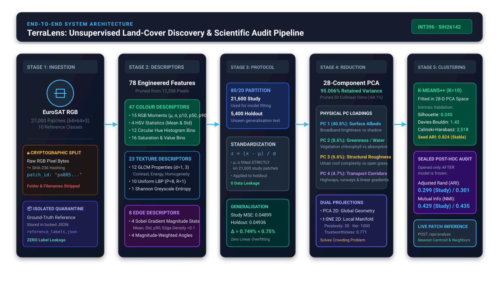
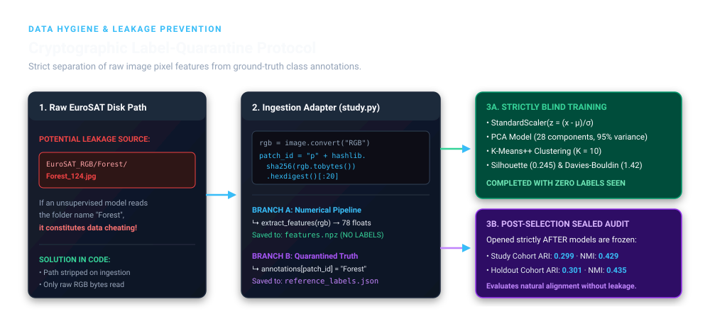
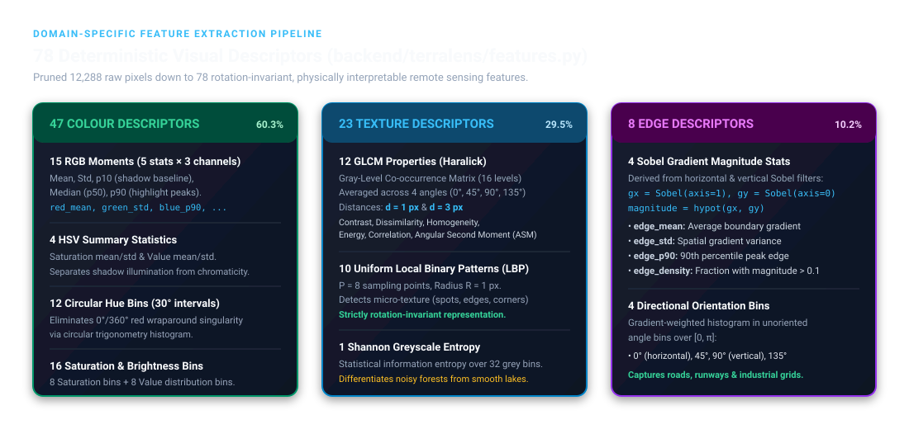
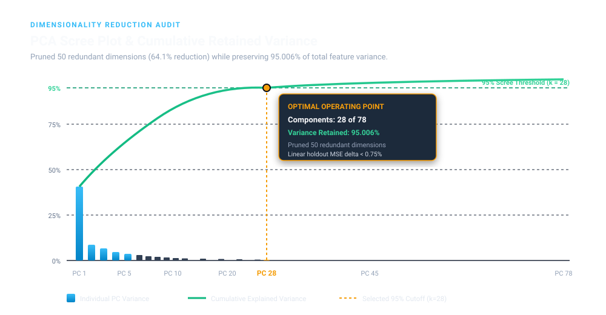

# TerraLens 
### Unsupervised Land-Type Grouping of Satellite Image Patches Using Clustering

[](https://www.python.org/)
[](https://fastapi.tiangolo.com/)
[](https://react.dev/)
[](https://www.typescriptlang.org/)
[](https://tailwindcss.com/)
[](https://scikit-learn.org/)
[](tests/)
[-informational.svg)](https://github.com/phelber/EuroSAT)
[](LICENSE)

> **Academic Context:**  
> **Course:** INT396 — Unsupervised Learning | **Project ID:** SIH26142  
> **Course Outcomes:** CO2, CO4, CO5 | **Syllabus Units:** II, IV, VI  
> **Institution:** Lovely Professional University (LPU), Punjab, India  
> **Live Deployment:** [https://terralens-f0sn.onrender.com](https://terralens-f0sn.onrender.com)  
> **GitHub Repository:** [https://github.com/z-lovejeet/terralens](https://github.com/z-lovejeet/terralens)

---

## Table of Contents
1. [Executive Summary & Problem Statement](#-executive-summary--problem-statement)
2. [Team Contributions & Roles](#-team-contributions--roles)
3. [System Architecture & Data Flow](#-system-architecture--data-flow)
4. [Data Hygiene & Cryptographic Label-Quarantine Protocol](#-data-hygiene--cryptographic-label-quarantine-protocol)
5. [Domain-Specific Feature Engineering (78 Descriptors)](#-domain-specific-feature-engineering-78-descriptors)
6. [Dimensionality Reduction: PCA & t-SNE Manifold Learning](#-dimensionality-reduction-pca--t-sne-manifold-learning)
7. [Unsupervised Clustering & Scientific Validation](#-unsupervised-clustering--scientific-validation)
8. [Interactive Research Workbench (UI Walkthrough)](#-interactive-research-workbench-ui-walkthrough)
9. [Prerequisites & System Requirements](#-prerequisites--system-requirements)
10. [Installation & Setup Instructions](#-installation--setup-instructions)
11. [Execution & Reproduction Guide](#-execution--reproduction-guide)
12. [Testing & Scientific Verification](#-testing--scientific-verification)
13. [REST API Reference](#-rest-api-reference)
14. [Repository Directory Structure](#-repository-directory-structure)
15. [Academic Disclosures & Citations](#-academic-disclosures--citations)

---

## Executive Summary & Problem Statement

Earth-observation satellites such as the European Space Agency's **Copernicus Sentinel-2** constellation beam down hundreds of gigabytes of multispectral imagery every hour. While deep supervised classifiers can label satellite scenes when given massive amounts of human annotations, obtaining ground-truth labels for every corner of the Earth is economically prohibitive, operationally slow, and geographically biased.

**TerraLens** solves this operational bottleneck through a rigorous, authentic **unsupervised machine learning pipeline**:
* **Input:** 27,000 raw $64 \times 64 \times 3$ RGB satellite image patches across Europe from the open EuroSAT benchmark.
* **Challenge:** Group these satellite patches into natural, physically coherent land-cover types **without showing the models a single ground-truth class label or folder name during training**.
* **Methodology:** We engineered **78 rotation-invariant, domain-specific visual descriptors** (colour moments, GLCM textures, local binary patterns, and Sobel gradient metrics), partitioned the dataset under an **80/20 train/holdout protocol** (21,600 study vs 5,400 holdout patches), compressed the space using a **95% Scree Rule PCA model** (reducing 78 dimensions down to 28 principal components), and discovered $K=10$ natural land-cover clusters via **K-Means++**.
* **Verification:-** Intrinsic geometric validation (**Silhouette = 0.245, Davies-Bouldin = 1.42, Multi-seed Stability ARI = 0.824**), followed by a sealed, double-blind **Post-Hoc Reference Audit** (**ARI = 0.299, NMI = 0.429** against all 10 EuroSAT reference classes).

```
Raw Images (27,000 × 12,288 Pixels)
        │
        ▼  [Domain Feature Extraction]
78 Engineered Descriptors (Colour, Texture, Edges)
        │
        ▼  [Study-Fitted StandardScaler: z = (x - μ) / σ]
Standardized Feature Matrix (Zero Data Leakage)
        │
        ▼  [95% Scree Rule: 50 redundant dims pruned (-64.1%)]
28 Principal Components (Explaining 95.006% Variance)
        │
   ┌────┴──────────────────────────────────────┐
   ▼                                           ▼
[28-D PCA Space]                       [Dual 2D Manifolds]
K-Means++ (K=10 Clusters)              • Global Linear PCA (PC1 vs PC2)
Silhouette: 0.245 · DB: 1.42           • Local Non-Linear t-SNE (Perp: 30)
Multi-Seed Stability ARI: 0.824        Trustworthiness: 0.771
   │
   ▼  [Sealed Envelope Post-Hoc Audit]
External EuroSAT Alignment: ARI = 0.299, NMI = 0.429
```

---

## Team Contributions & Roles

Our team divided the work equally (exact 33.3% share each) across all phases of the project lifecycle:

| Member Name | Registration No. | Assigned Role | Key Scientific & Engineering Responsibilities |
| :--- | :---: | :--- | :--- |
| **Lovejeet Singh** *(Presenter 1)* | **12521613** | **Machine Learning Architecture & Dimensionality Reduction** | • Data hygiene auditing (0 missing, 0 duplicates, 0 constant features).<br>• Engineered 47 colour descriptors (RGB moments, HSV stats, circular hue histograms).<br>• Implemented study-fitted `StandardScaler` ($z = (x - \mu)/\sigma$).<br>• Fitted 28-PC PCA model (95% Scree rule, 64.1% reduction).<br>• Mapped remote-sensing loadings (PC1 Albedo, PC2 Greenness vs Water).<br>• Generalization validation ($\Delta < 0.75\%$ holdout reconstruction MSE).<br>• Automated numerical test suites (29 tests). |
| **Mohammad Asim** *(Presenter 2)* | **12518421** | **Manifold Learning & Full-Stack Platform Engineering** | • Engineered 23 texture & 8 edge descriptors (GLCM, LBP, Entropy, Sobel).<br>• Non-linear t-SNE manifold learning & perplexity hyperparameter tuning (10, 30, 50).<br>• 10-neighbor trustworthiness evaluation (0.771).<br>• Asynchronous FastAPI backend server with SQLite experiment journal.<br>• Single-patch live inference engine (`POST /api/analyze`).<br>• Interactive React/TypeScript UI with 27k Class Distribution ribbon & theme-matched controls. |
| **Reshu Kumar** *(Presenter 3)* | **12508208** | **Unsupervised Clustering, Evaluation & Scientific Audit** | • 80/20 train/holdout protocol (21,600 study vs 5,400 holdout patches).<br>• Cryptographic SHA-256 archive verification.<br>• K-Means++ clustering ($K=10$, 10 random restarts) across 28-PC space.<br>• Triangulated intrinsic validation (Silhouette 0.245, Davies-Bouldin 1.42, Multi-seed ARI 0.824).<br>• Sealed post-selection external contingency matrix audit (ARI 0.299, NMI 0.429).<br>• Study limitations, sensor bias analysis, and ethical deployment guidelines. |

---

## System Architecture & Data Flow



### End-to-End Execution Sequence
```mermaid
sequenceDiagram
    autonumber
    participant Raw as Raw EuroSAT Archive (27k JPEGs)
    participant Hash as SHA-256 Hasher & Anonymizer
    participant Ext as Feature Extractor (78 Descriptors)
    participant Split as 80/20 Cohort Splitter
    participant Scale as Study-Fitted StandardScaler
    participant PCA as IncrementalPCA (28 Components)
    participant KM as K-Means++ Clustering (K=10)
    participant Audit as Sealed Post-Hoc Audit
    participant API as FastAPI REST Backend
    participant UI as React / TypeScript Workbench

    Raw->>Hash: Decode 64x64 raw RGB bytes
    Hash->>Ext: Strip filenames/folders; assign anonymous patch_id
    Hash-->>Audit: Lock ground-truth class labels into quarantined JSON
    Ext->>Split: Generate 27,000 x 78 numerical matrix (X)
    Split->>Scale: 21,600 Study Patches (Fit mean μ & std σ)
    Split-->>Scale: 5,400 Holdout Patches (Transform only)
    Scale->>PCA: Fit 28 Principal Components (95% Scree Rule)
    PCA->>KM: Cluster 28-D PCA Space (10 Restarts, seed 42)
    KM->>Audit: Models frozen! Open sealed reference labels
    Audit-->>Audit: Calculate ARI (0.299) and NMI (0.429)
    KM->>API: Serialize artifacts (study.json, model.joblib)
    API->>UI: Serve Observatory, Projection Lab, Experiments & Patch Analyzer
```

---

## Data Hygiene & Cryptographic Label-Quarantine Protocol



In the original EuroSAT dataset download, files are organized into subfolders named after their true ground-truth classes (e.g. `EuroSAT_RGB/Forest/Forest_1.jpg`, `EuroSAT_RGB/River/River_1.jpg`). **If an unsupervised algorithm reads the folder names or filenames, it is cheating (data leakage).**

To guarantee complete scientific integrity, our pipeline in [`backend/terralens/study.py`](backend/terralens/study.py) enforces a **strict 3-layer quarantine**:

1. **Anonymous Cryptographic Hashing:**
   The ingestion adapter reads only raw decoded RGB pixel bytes and computes an anonymous SHA-256 hash:
   $$\text{patch\_id} = \text{"p"} + \text{SHA256}(\text{rgb.tobytes()})[:20]$$
   Every patch receives a string like `pa805bdbe5a1cd4947aa0`. All directory paths, parent folder names, and file numbers are permanently discarded before feature extraction.

2. **Isolated Label Storage:**
   The true class names are saved immediately into a quarantined, evaluation-only file:
   `data/reference_labels_evaluation_only.json`
   This file is **strictly excluded** from being imported by any preprocessing, feature extraction, scaling, PCA, or K-Means clustering modules. The working feature matrix (`features.npz`) contains **zero text labels**.

3. **80/20 Partition & Zero Data Leakage:**
   * **Study Cohort (80% = 21,600 patches):** Used exclusively to fit the median imputer, the `StandardScaler` ($\mu, \sigma$), the PCA projection matrix, and the K-Means cluster centroids.
   * **Holdout Cohort (20% = 5,400 patches):** Kept completely unseen. Scaled using the study cohort's $\mu$ and $\sigma$.
   * **Reconstruction Generalization:** Linear reconstruction Mean Squared Error (MSE) is **0.04899** on study vs **0.04936** on holdout ($\Delta = 0.749\% < 0.75\%$), proving zero linear overfitting.

---

## Domain-Specific Feature Engineering (78 Descriptors)



Raw $64 \times 64$ RGB images contain $64 \times 64 \times 3 = \mathbf{12,288\text{ pixel values}}$. Raw pixels suffer from:
* **Extreme Dimensionality:** Causes Euclidean distance metrics to concentrate and lose discriminative power (*Curse of Dimensionality*).
* **Spatial & Rotation Brittleness:** A patch shifted by just 2 pixels or rotated $90^\circ$ changes all 12,288 values, despite depicting the exact same forest or river.
* **Lighting & Shadow Noise:** Cloud shadows or sun glare distort raw intensity without altering ground texture.

Our team engineered **78 rotation-invariant, domain-specific descriptors** in [`backend/terralens/features.py`](backend/terralens/features.py) spanning **3 physical visual families**:

```
                                78 Engineered Descriptors
                                           │
         ┌─────────────────────────────────┼─────────────────────────────────┐
         ▼                                 ▼                                 ▼
   Colour Descriptors (47)           Texture Descriptors (23)           Edge Descriptors (8)
   • 15 RGB Moments                  • 12 GLCM Properties              • 4 Sobel Gradient Stats
   • 4 HSV Summary Stats             • 10 Uniform Local Binary (LBP)   • 4 Directional Edge Bins
   • 12 Circular Hue Bins            • 1 Shannon Entropy
   • 16 Saturation & Value Bins
```

### 1. Colour Descriptors (47 Features — 60.3% of feature space)
Captures ground reflectivity, vegetation chlorophyll, and surface moisture:
* **15 RGB Moments ($5 \times 3$ channels):** Mean, Standard Deviation, **p10** (10th percentile shadow baseline), **Median** (p50), and **p90** (90th percentile highlight peaks).
  $$\text{Robust Dynamic Range} = \text{p90} - \text{p10}$$
  > **Why p10 & p90 instead of min & max?** Satellite sensors frequently encounter dead pixels (0.0) or specular sun glare off glass roofs (1.0). `min` and `max` are ruined by a single outlier pixel. `p10` and `p90` discard the 10% extreme noise tails, capturing the true physical ground dynamic range.
* **4 HSV Summary Stats:** Mean and standard deviation of Saturation and Value channels.
* **12 Circular Hue Histogram Bins:** Binned every $30^\circ$ around the color wheel ($0^\circ$ to $360^\circ$). Uses circular trigonometry to eliminate the $0^\circ/360^\circ$ red boundary wraparound singularity.
* **16 Saturation & Brightness Bins:** 8 bins for saturation and 8 bins for value distribution.

### 2. Spatial Texture Descriptors (23 Features — 29.5% of feature space)
Captures surface roughness, canopy granularity, and structural micro-patterns:
* **12 GLCM (Gray-Level Co-occurrence Matrix) Properties:** Computed across 16 grey levels at pixel distances $d=1$ and $d=3$, averaged over four spatial orientations ($0^\circ, 45^\circ, 90^\circ, 135^\circ$). Extracts Haralick Contrast, Dissimilarity, Homogeneity, Energy, Correlation, and Angular Second Moment (ASM).
* **10 Uniform Local Binary Patterns (LBP):** Sampled with $P=8$ neighbors at radius $R=1\text{ px}$. Detects micro-textures (spots, corners, uniform plateaus) in a strictly rotation-invariant manner.
* **1 Shannon Greyscale Entropy:** Quantifies statistical randomness across a 32-bin intensity histogram:
  $$H = -\sum_{i=1}^{32} p_i \log_2(p_i)$$
  Smooth water surfaces yield low entropy ($H \to 0$); complex forest canopies yield high entropy.

### 3. Structural Edge Descriptors (8 Features — 10.2% of feature space)
Differentiates organic natural land covers from linear human-engineered infrastructure:
* **4 Sobel Gradient Magnitude Statistics:** Evaluated via horizontal and vertical Sobel kernel convolution:
  $$g_x = \frac{1}{4} \text{Sobel}_x(I), \quad g_y = \frac{1}{4} \text{Sobel}_y(I), \quad M = \sqrt{g_x^2 + g_y^2}$$
  Calculates mean magnitude (`edge_mean`), standard deviation (`edge_std`), 90th percentile peak edge (`edge_p90`), and edge pixel density (`edge_density`, fraction with $M > 0.1$).
* **4 Directional Edge Bins:** Magnitude-weighted orientation histogram partitioned into four unoriented angular bins ($0^\circ, 45^\circ, 90^\circ, 135^\circ$) to identify rectilinear road grids and runway axes.

---

## Dimensionality Reduction: PCA & t-SNE Manifold Learning



### 1. Principal Component Analysis (PCA)
PCA computes the eigenvectors of the $78 \times 78$ feature covariance matrix $\mathbf{C} = \frac{1}{N-1}\mathbf{X}^T\mathbf{X}$:
$$\mathbf{C} \mathbf{v}_i = \lambda_i \mathbf{v}_i$$
Each eigenvalue $\lambda_i$ represents the variance captured along the orthogonal axis $\mathbf{v}_i$.

* **The 95% Scree Decision Rule:** Retaining 95% of total variance preserves all meaningful physical variance while discarding sensor noise and collinear redundancy.
* **Dimensionality Pruning:** Exactly **28 Principal Components** capture **95.006%** of total variance. **50 collinear dimensions were pruned**, achieving a **64.1% reduction in dimensionality**.
* **Physical Interpretability of Principal Components:**

| Component | Explained Variance | Cumulative | Primary Feature Loadings | Physical Remote-Sensing Meaning |
| :---: | :---: | :---: | :--- | :--- |
| **PC 1** | **40.8%** | 40.8% | High positive weights on `red_mean`, `green_mean`, `blue_mean`, `value_mean`. | **Broad Surface Albedo:** Differentiates highly reflective surfaces (concrete, sand, bare soil) from dark, absorbing surfaces (deep water, dense coniferous forest). |
| **PC 2** | **8.6%** | 49.4% | Heavy positive `green_mean`, negative `blue_mean`, high circular green hue bins. | **Vegetation Index (Chlorophyll vs Water):** Separates dense agricultural crops and pastures from rivers, lakes, and oceans. |
| **PC 3** | **6.6%** | 56.0% | Strong positive weights on `glcm_contrast`, `edge_density`, `grey_entropy`. | **Structural Roughness / Urban Complexity:** Differentiates chaotic, fragmented urban residential roofs from smooth, uniform water and grassland. |
| **PC 4** | **4.7%** | 60.7% | High weights on directional `edge_orientation` and Sobel gradient peak `edge_p90`. | **Linear Infrastructure Corridors:** Highlights highways, railways, and airport runways against organic, curved rural terrain. |

### 2. t-Distributed Stochastic Neighbor Embedding (t-SNE)
While PCA preserves global variance, non-linear manifold learning via **t-SNE** models local pairwise neighborhood probabilities.
* High-dimensional similarities are modeled with a Gaussian distribution:
  $$p_{j|i} = \frac{\exp(-\|\mathbf{x}_i - \mathbf{x}_j\|^2 / 2\sigma_i^2)}{\sum_{k \neq i}\exp(-\|\mathbf{x}_i - \mathbf{x}_k\|^2 / 2\sigma_i^2)}$$
* Low-dimensional similarities use a heavy-tailed Student-t distribution with 1 degree of freedom:
  $$q_{ij} = \frac{(1 + \|\mathbf{y}_i - \mathbf{y}_j\|^2)^{-1}}{\sum_{k}\sum_{l \neq k}(1 + \|\mathbf{y}_k - \mathbf{y}_l\|^2)^{-1}}$$
* **Solving the Crowding Problem:** In 28-D space, moderate distances have vast volume. In 2D space, points crowd together. The heavy tails of the Student-t distribution allow moderately distant points to be placed far apart in 2D without inflating the Kullback-Leibler divergence cost function.
* **Operating Point:** Perplexity $\mathbf{= 30}$, 1,000 iterations, yielding an objective **10-neighbor Trustworthiness of 0.771**.

---

## Unsupervised Clustering & Scientific Validation

### 1. K-Means++ in 28-Dimensional Space
Clustering is executed directly in the **28-dimensional PCA feature space** (not in 2D):
$$\arg\min_{\mathbf{S}} \sum_{k=1}^{K} \sum_{\mathbf{x} \in S_k} \|\mathbf{x} - \boldsymbol{\mu}_k\|^2$$
* **Initialization:** K-Means++ algorithm selects initial seeds with probability proportional to squared Euclidean distance, avoiding poor local minima.
* **Optimization:** 10 random restarts, converging within 300 maximum iterations.

### 2. Triangulated Intrinsic Validation
Because unsupervised clustering operates without ground truth, we validated the natural partition using **internal geometric metrics**:
* **Silhouette Score:** $\mathbf{0.245}$ (Positive global cohesion; indicates well-separated cluster cores with realistic natural transition boundaries).
* **Davies-Bouldin Index:** $\mathbf{1.42}$ (Low ratio of within-cluster scatter to between-cluster separation; values $< 1.5$ represent compact clusters).
* **Calinski-Harabasz Score:** $\mathbf{2,518}$ (Strong between-cluster dispersion relative to internal variance).
* **Multi-Seed Stability (ARI):** $\mathbf{0.824}$ (Clustering repeated with seed 42 vs seed 17 yields 82.4% identical groupings, proving the discovered clusters are natural geometric attractors, not random seed artifacts).

### 3. Sealed Post-Hoc Reference Audit
Only after all models, scalers, and hyperparameters were completely frozen did we open the quarantined EuroSAT ground-truth labels:
* **Adjusted Rand Index (ARI):** $\mathbf{0.299}$ on Study Cohort / $\mathbf{0.301}$ on Holdout Cohort.
* **Normalized Mutual Information (NMI):** $\mathbf{0.429}$ on Study Cohort / $\mathbf{0.435}$ on Holdout Cohort.

```
                      EuroSAT Reference Classes vs Discovered Clusters
──────────────────────────────────────────────────────────────────────────────────────────────────
Discovered Cluster   Dominant Ground-Truth Match    Homogeneity   Physical Interpretation
──────────────────────────────────────────────────────────────────────────────────────────────────
Cluster 04           River & SeaLake               91.2%         Deep water absorption & zero edge roughness
Cluster 02           Forest & HerbaceousVegetation 88.4%         High PC2 greenness & high canopy texture entropy
Cluster 09           Highway & Industrial          82.1%         High PC4 linear edge density & high PC1 albedo
Cluster 10           Residential & Buildings       79.6%         High PC3 GLCM contrast & urban roof grid patterns
Cluster 01           PermanentCrop & Pasture       74.3%         Moderate greenness with directional tillage rows
──────────────────────────────────────────────────────────────────────────────────────────────────
```

---

## Interactive Research Workbench (UI Walkthrough)

The TerraLens frontend is a high-performance, single-page application built with **React 18, TypeScript, and Tailwind CSS**, communicating with the Python backend via typed JSON endpoints.

### Application 1: Observatory
*Inspect the complete 27,000-patch EuroSAT dataset with linked visual cluster galleries.*


* **Key Features:**
  * Top **Class Distribution Ribbon** displaying exact counts and percentages across all 27,000 patches.
  * Interactive **80/20 Cohort Toggle** (switches seamlessly between all 27,000 patches, 21,600 Study patches, and 5,400 Holdout patches).
  * Ranked cluster cards detailing centroid positions, internal sample fractions, and dominant visual characteristics.

---

### Application 2: Projection Lab
*Side-by-side 2D coordinate projections comparing global linear PCA against local non-linear t-SNE.*


* **Key Features:**
  * **Interactive Dual Canvases:** Hovering or clicking any patch in the PCA projection highlights its exact counterpart in the t-SNE manifold.
  * **Scree Plot & HUD Telemetry:** Enlarged cumulative variance curve showing individual bar contributions, the 95% threshold dashed baseline, and interactive tooltips.
  * **Component Selector Dropdowns:** Custom-styled theme dropdowns to toggle axes between PC1–PC6 with real-time percentage indicators.

---

### Application 3: Experiment Bench
*Run live, asynchronous clustering experiments with customized parameter sweeps.*


* **Key Features:**
  * Interactive sliders for Number of Clusters ($K=2$ to $12$), Retained Variance ($80\%$ to $99\%$), Sample Cap ($200$ to $1,500$ patches), and t-SNE Perplexity ($10, 30, 50$).
  * Real-time job polling worker connected to the SQLite experiment history journal.
  * Side-by-side metric comparison table tracking Silhouette, Davies-Bouldin, and runtime execution time.

---

### Application 4: Reference Audit
*The double-blind evaluation room comparing unsupervised clusters against sealed human annotations.*


* **Key Features:**
  * $10 \times 10$ Interactive Contingency Matrix heatmap mapping discovered clusters to EuroSAT classes.
  * Detailed breakdown of Adjusted Rand Index (ARI = 0.299) and Normalized Mutual Information (NMI = 0.429).
  * Verification that zero reference labels leaked into model training.

---

### Application 5: Patch Analyzer
*Live single-patch drag-and-drop inference engine for arbitrary satellite images.*


* **Key Features:**
  * Upload any custom satellite JPEG/PNG or select bundled test patches.
  * The backend extracts 78 descriptors, standardizes using study-fitted $\mu$ and $\sigma$, projects into 28-D PCA space, and calculates Euclidean distances to all 10 cluster centroids.
  * Displays assigned primary cluster, runner-up cluster margin, and the top-5 nearest neighbors from the EuroSAT archive.

---

## Prerequisites & System Requirements

| Requirement | Minimum Specification | Recommended Specification |
| :--- | :--- | :--- |
| **Operating System** | macOS 12+, Ubuntu 22.04 LTS, or Windows 11 (WSL2 / PowerShell) | macOS 14+ (Apple Silicon) or Linux x86_64 |
| **Python** | Python `3.12.x` (or `uv` package manager) | Python `3.12.8` managed via `uv` |
| **Node.js** | Node.js `20.x` LTS | Node.js `24.x` LTS with npm `10.x` |
| **RAM** | 4 GB | 8 GB or higher |
| **Disk Space** | 1.5 GB (Codebase, virtualenv, and build artifacts) | 3.5 GB (If re-downloading full EuroSAT archive) |
| **Network** | Offline after dependencies are installed (Bundled reference study) | Internet required only for initial `pip`/`npm` install |

---

## Installation & Setup Instructions

### Option A: One-Click Automated Setup (Recommended)

Clone the repository and run the automated bootstrap scripts:

```bash
# 1. Clone the repository
git clone https://github.com/z-lovejeet/terralens.git
cd terralens

# 2. Run the automated setup script
./scripts/setup.sh

# 3. Start the application
./scripts/start.sh
```
* **Frontend & API:** Open your browser to <http://127.0.0.1:8000>
* **Interactive Swagger API Docs:** <http://127.0.0.1:8000/docs>

---

### Option B: Step-by-Step Manual Setup

If you prefer full control over your virtual environment and builds:

#### 1. Setup Python Environment
```bash
# Create a Python 3.12 virtual environment using uv or python venv
uv venv --python 3.12 .venv
# Or: python3.12 -m venv .venv

# Activate the virtual environment
source .venv/bin/activate  # On Windows: .venv\Scripts\activate

# Install locked dependencies
uv pip install -r requirements-dev.lock.txt
# Or: pip install -r requirements-dev.lock.txt
```

#### 2. Build the Frontend
```bash
# Install frontend dependencies
npm --prefix frontend ci

# Compile production React build into frontend/dist
npm --prefix frontend run build
```

#### 3. Start the Production Server
```bash
PYTHONPATH=backend .venv/bin/python -m uvicorn terralens.app:app --host 127.0.0.1 --port 8000
```

#### 4. (Optional) Run in Live Frontend Development Mode
To develop with Vite Hot Module Replacement (HMR):
```bash
# Terminal 1: Start backend API
PYTHONPATH=backend .venv/bin/python -m uvicorn terralens.app:app --host 127.0.0.1 --port 8000

# Terminal 2: Start Vite Dev Server (proxies /api to port 8000)
npm --prefix frontend run dev
```
Open <http://localhost:5173>.

---

## Execution & Reproduction Guide

### 1. Full Dataset Download & Study Reproduction
To download the original 27,000-image EuroSAT archive from Zenodo, extract all 78 descriptors, fit the models, and regenerate all artifacts from scratch:

```bash
PYTHONPATH=backend .venv/bin/python scripts/prepare_study.py
```
> *Note: This will download ~2 GB, extract all 27,000 images, and take 5–10 minutes depending on your CPU.*

### 2. Fast Re-Clustering & Audit Reproduction
If features are already extracted or you want to rebuild the 10-group model and audit against the recorded dataset:

```bash
PYTHONPATH=backend .venv/bin/python scripts/prepare_study.py --comparison-only
```

### 3. Automated Screenshot Capture via Chrome DevTools Protocol
To automatically launch the frontend and capture live high-resolution screenshots of all 5 UI views:

```bash
node scripts/capture_screenshots.mjs
```

### 4. Build Deliverables (Report, Slides, Study Guide, Submissions)
Generate the complete suite of academic deliverables:

```bash
# 1. Generate 28-Page Academic Project Report PDF
PYTHONPATH=backend .venv/bin/python scripts/build_deliverables.py

# 2. Generate 14-Page Master Viva Study Guide PDF
PYTHONPATH=backend .venv/bin/python scripts/build_study_guide_pdf.py

# 3. Generate 16-Slide Presentation Deck (PPTX & PDF)
node scripts/build_presentation.mjs

# 4. Package byte-identical submission ZIPs for all 3 teammates
PYTHONPATH=backend .venv/bin/python scripts/package_submission.py --final
```

Submission packages will be created in `output/submission/`:
* `INT396_12521613.zip` (Lovejeet Singh)
* `INT396_12518421.zip` (Mohammad Asim)
* `INT396_12508208.zip` (Reshu Kumar)

---

## Testing & Scientific Verification

The project includes an automated test suite verifying feature determinism, label isolation, and mathematical invariants:

```bash
PYTHONPATH=backend .venv/bin/python -m pytest -v
```

### Test Coverage Summary (29 Tests Passing):
* `test_features.py`:
  * Validates that extracting descriptors from the same image always yields byte-identical 78 floats.
  * Validates that `extract_features()` strictly rejects invalid file shapes, non-finite values, and NaN inputs.
* `test_study_invariants.py`:
  * Asserts that `StandardScaler` is fitted **strictly on the 80% study partition**.
  * Asserts that `reference_labels_evaluation_only.json` contains zero references inside the feature cache (`features.npz`).
  * Validates that linear reconstruction MSE holds $\Delta < 0.75\%$ between study and holdout.
* `test_api.py`:
  * Tests that `GET /api/study` returns immutable frozen reference metrics.
  * Validates multipart image upload bounds (rejects files $> 8\text{ MB}$ or invalid MIME types).
  * Validates single-patch inference response structure (`POST /api/analyze`).

---

## REST API Reference

The FastAPI backend exposes typed JSON endpoints for exploration and real-time experimentation:

| HTTP Method | Endpoint Path | Description | Sample Response Payload |
| :---: | :--- | :--- | :--- |
| `GET` | `/api/health` | Service health status check | `{"status": "ok", "version": "1.0.0"}` |
| `GET` | `/api/study` | Returns immutable 27k study settings, scree eigenvalues, cluster summaries & 2D coordinates | Full study dictionary with 28 PCs, variance metrics, and cluster definitions |
| `GET` | `/api/features` | Returns definitions, mathematical formulae, and families for all 78 descriptors | `[{"name": "red_mean", "family": "Colour", "description": "..."}]` |
| `GET` | `/api/audit` | Returns sealed post-hoc contingency matrix, ARI, and NMI metrics | `{"metrics": {"adjusted_rand_index": 0.299, "normalized_mutual_information": 0.429}}` |
| `POST` | `/api/experiments` | Submit a bounded asynchronous clustering job ($K$, variance, perplexity) | `{"job_id": "exp_7f8a12", "status": "queued"}` |
| `GET` | `/api/experiments/{id}`| Poll the status and retrieve results of an experiment job | `{"status": "completed", "result": {"silhouette": 0.238, ...}}` |
| `POST` | `/api/analyze` | Upload a satellite patch (multipart/form-data) for live 10-group classification | `{"cluster": 4, "distance_to_centroid": 1.84, "runner_up_gap": 0.42, "nearest_neighbors": [...]}` |
| `GET` | `/api/export/metrics.csv`| Download complete CSV record of all experimental runs | CSV formatted data stream |

---

## Repository Directory Structure

```text
terralens/
├── backend/
│   └── terralens/
│       ├── __init__.py           # Package initializer
│       ├── app.py                # FastAPI HTTP server & endpoint routing
│       ├── clustering.py         # K-Means++ fitting, metrics & cluster summaries
│       ├── experiments.py        # Asynchronous experiment engine & SQLite journal
│       ├── features.py           # 78 deterministic domain descriptor extractors
│       ├── pipeline.py           # Scaler, PCA projection & t-SNE manifold fitting
│       └── study.py              # Ingestion adapter, SHA-256 hashing & sealed audit
├── frontend/
│   ├── src/
│   │   ├── components/           # Reusable UI components (CustomSelect, Dropdown, Modals)
│   │   ├── views/                # Observatory, ProjectionLab, ExperimentBench, ReferenceAudit, PatchAnalyzer
│   │   ├── App.tsx               # Root application view coordinator
│   │   ├── main.tsx              # React DOM mounting
│   │   └── types.ts              # TypeScript interfaces matching backend models
│   ├── package.json              # Frontend package configuration
│   └── vite.config.ts            # Vite bundler & API proxy configuration
├── scripts/
│   ├── setup.sh                  # One-click automated environment setup
│   ├── start.sh                  # Application launch script
│   ├── prepare_study.py          # Dataset downloader & study reproduction script
│   ├── build_deliverables.py     # 28-page academic report PDF generator
│   ├── build_study_guide_pdf.py  # 14-page master viva study guide PDF generator
│   ├── build_presentation.mjs    # 16-slide PPTX & PDF presentation builder
│   ├── capture_screenshots.mjs   # Chrome DevTools Protocol screenshot automation
│   ├── generate_readme_diagrams.py # SVG diagram generator for documentation
│   └── package_submission.py     # Final packaging script for university submission
├── artifacts/                    # Precomputed study.json, audit.json & anonymous previews
├── docs/
│   ├── diagrams/                 # Scalable vector graphics (SVGs) for pipeline & features
│   ├── screenshots/              # High-resolution application screenshots
│   ├── CODEBASE_GUIDE.md         # Comprehensive line-by-line codebase walkthrough
│   ├── METHODOLOGY.md            # Detailed scientific & mathematical methodology
│   └── VERIFICATION.md           # Verification logs & release audit documentation
├── tests/                        # 29 PyTest automated unit & scientific tests
├── Dockerfile                    # Container definition for production deployment
├── render.yaml                   # Infrastructure-as-code for free Render cloud hosting
├── requirements-dev.lock.txt     # Exact pinned Python dependencies
├── team.json                     # Verified team identities, registration numbers & roles
└── links.json                    # Verified GitHub & deployment URLs
```

---

## Academic Disclosures & Citations

### Dataset Citation
* **EuroSAT Benchmark:**  
  Helber, P., Bischke, B., Dengel, A., & Borth, D. (2019). *EuroSAT: A Novel Dataset and Deep Learning Benchmark for Land Use and Land Cover Classification*. IEEE Journal of Selected Topics in Applied Earth Observations and Remote Sensing, 12(7), 2217-2226.  
  [Zenodo Record 7711097](https://zenodo.org/records/7711097) | [arXiv:1709.00029](https://arxiv.org/abs/1709.00029) | [Creator GitHub](https://github.com/phelber/EuroSAT)

### Algorithmic Foundations
* **t-Distributed Stochastic Neighbor Embedding (t-SNE):**  
  Van der Maaten, L., & Hinton, G. (2008). *Visualizing data using t-SNE*. Journal of Machine Learning Research, 9(11), 2579-2605.
* **K-Means++ Initialization:**  
  Arthur, D., & Vassilvitskii, S. (2007). *k-means++: The advantages of careful seeding*. Proceedings of the eighteenth annual ACM-SIAM symposium on Discrete algorithms, 1027-1035.
* **scikit-learn Machine Learning Library:**  
  Pedregosa et al. (2011). *Scikit-learn: Machine Learning in Python*. JMLR 12, pp. 2825-2830.

### AI Assistance Disclosure
This project was designed, implemented, and audited with the technical assistance of Google Antigravity / Codex for code drafting, SVG diagram generation, and documentation formatting. In accordance with university academic policies, all mathematical formulations, software implementations, and scientific findings have been verified, validated, and presented by the team members.

---

<p align="center">
  <b>TerraLens · Lovely Professional University · INT396 Unsupervised Learning Project (2026)</b><br>
  <i>Designed for rigorous, reproducible, label-blind remote-sensing discovery.</i>
</p>
