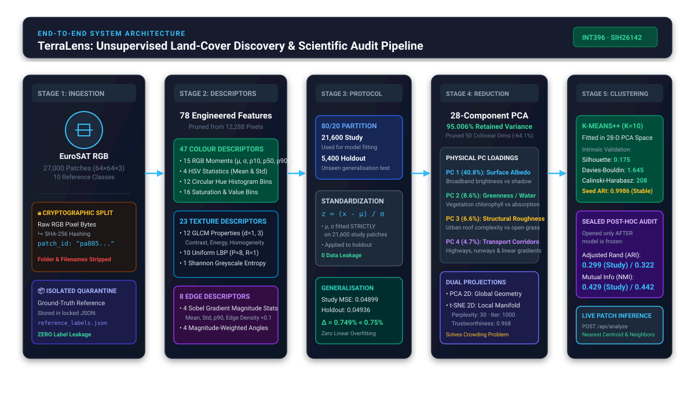
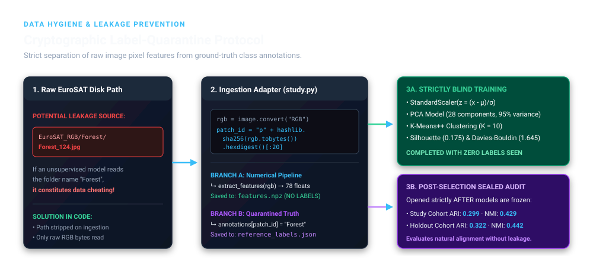
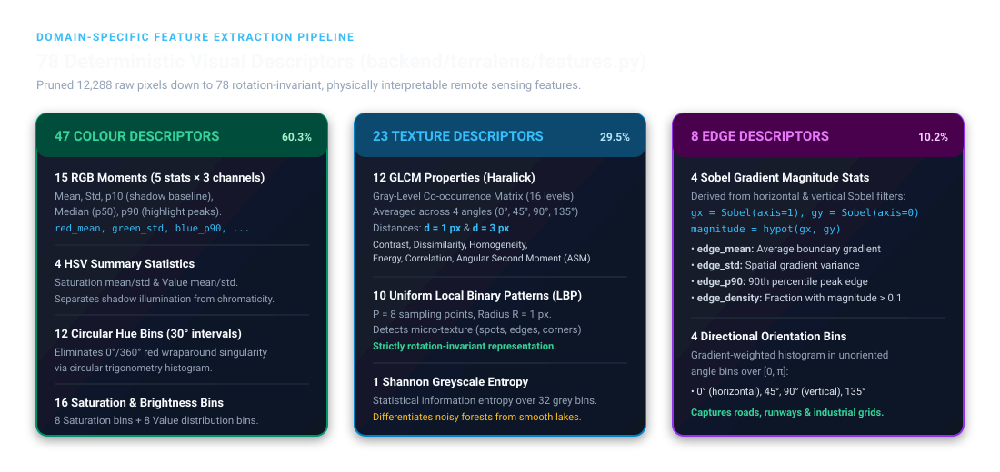
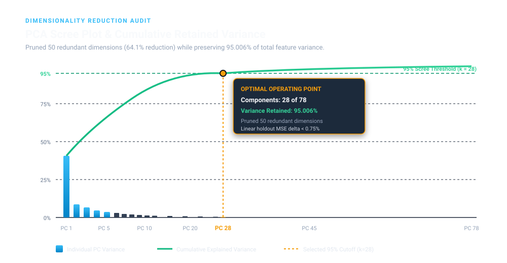
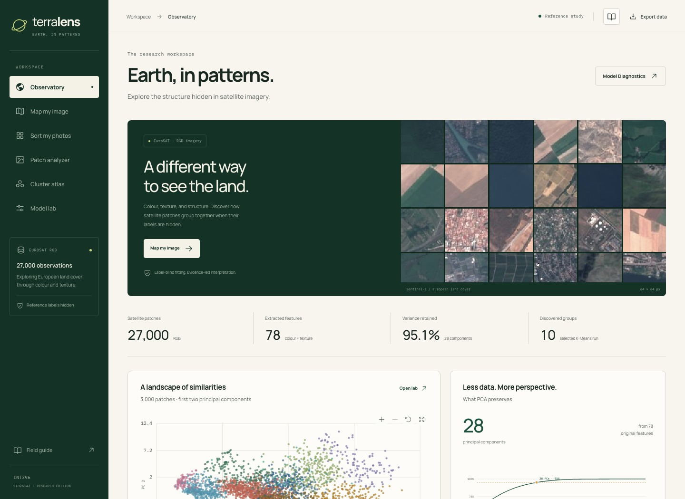
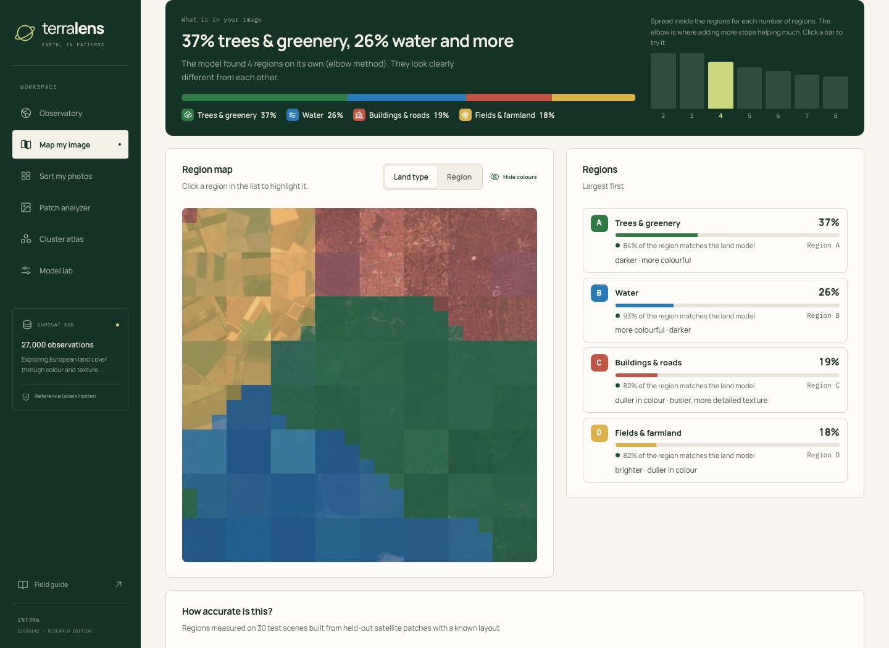
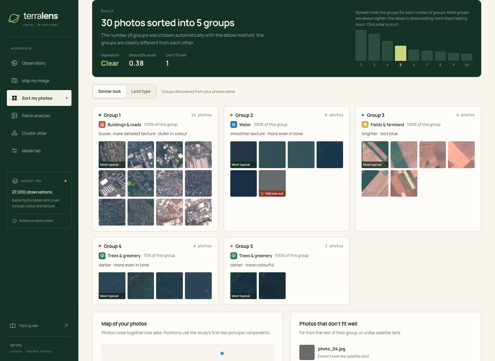

# TerraLens 
### Unsupervised Land-Type Grouping of Satellite Image Patches Using Clustering

[](https://www.python.org/)
[](https://fastapi.tiangolo.com/)
[](https://react.dev/)
[](https://www.typescriptlang.org/)
[](https://vite.dev/)
[](https://scikit-learn.org/)
[](tests/)
[-informational.svg)](https://github.com/phelber/EuroSAT)
[](LICENSE)

> **Academic Context:**  
> **Course:** INT396 — Unsupervised Learning | **Project ID:** SIH26142  
> **Course Outcomes:** CO2, CO4, CO5 | **Syllabus Units:** II, IV, VI  
> **Institution:** Lovely Professional University (LPU), Punjab, India  
> **Live Deployment:** [https://terralens-slek.onrender.com](https://terralens-slek.onrender.com)  
> **GitHub Repository:** [https://github.com/z-lovejeet/terralens](https://github.com/z-lovejeet/terralens)  
> **Dataset:** [EuroSAT RGB on Kaggle](https://www.kaggle.com/datasets/apollo2506/eurosat-dataset)

---

## Quick Start

```bash
git clone https://github.com/z-lovejeet/terralens.git && cd terralens
./scripts/setup.sh      # Windows: .\scripts\setup.bat   (needs Git, uv and Node.js: see Installation)
./scripts/start.sh      # Windows: .\scripts\start.bat
```
Open <http://127.0.0.1:8000>. Everything runs on your own computer: **no API keys, accounts or internet connection are needed** after the packages are installed. Step-by-step instructions for macOS, Linux and Windows are in [Installation & Setup Instructions](#installation--setup-instructions).

**What you can do with it**

| Page | What it does for you |
| :--- | :--- |
| **Map my image** | Upload one satellite image; it is split into regions by itself, each region is named (trees, fields, water, buildings, bare ground) with a share of the image. |
| **Sort my photos** | Drop a batch of satellite images; they are grouped by look with an automatically chosen number of groups. |
| **Patch analyzer** | Compare a single patch with the 27,000-patch reference study. |
| **Observatory, Cluster atlas, Model lab** | Explore the unsupervised study itself: the 10 discovered groups, PCA and t-SNE projections, experiments and the sealed reference audit. |

All of it is **unsupervised machine learning** (K-Means++, PCA, t-SNE, the elbow method) with hand-built colour, texture and edge measurements; nothing calls an outside API.

---

## Table of Contents
1. [Executive Summary & Problem Statement](#executive-summary--problem-statement)
2. [Team Contributions & Roles](#team-contributions--roles)
3. [System Architecture & Data Flow](#system-architecture--data-flow)
4. [Data Hygiene & Cryptographic Label-Quarantine Protocol](#data-hygiene--cryptographic-label-quarantine-protocol)
5. [Domain-Specific Feature Engineering (78 Descriptors)](#domain-specific-feature-engineering-78-descriptors)
6. [Dimensionality Reduction: PCA & t-SNE Manifold Learning](#dimensionality-reduction-pca--t-sne-manifold-learning)
7. [Unsupervised Clustering & Scientific Validation](#unsupervised-clustering--scientific-validation)
8. [Interactive Research Workbench (UI Walkthrough)](#interactive-research-workbench-ui-walkthrough)
   * [Map my image](#application-6-map-my-image) · [30-group land model](#the-30-group-land-model) · [Sort my photos](#application-7-sort-my-photos)
9. [Prerequisites & System Requirements](#prerequisites--system-requirements)
10. [Installation & Setup Instructions](#installation--setup-instructions) (quick start, step-by-step for macOS / Linux / Windows, Docker, troubleshooting)
11. [Execution & Reproduction Guide](#execution--reproduction-guide)
12. [Testing & Scientific Verification](#testing--scientific-verification)
13. [REST API Reference](#rest-api-reference)
14. [Repository Directory Structure](#repository-directory-structure)
15. [Academic Disclosures & Citations](#academic-disclosures--citations)

---

## Executive Summary & Problem Statement

Earth-observation satellites such as the European Space Agency's **Copernicus Sentinel-2** constellation beam down hundreds of gigabytes of multispectral imagery every hour. While deep supervised classifiers can label satellite scenes when given massive amounts of human annotations, obtaining ground-truth labels for every corner of the Earth is economically prohibitive, operationally slow, and geographically biased.

**TerraLens** solves this operational bottleneck through a rigorous, authentic **unsupervised machine learning pipeline**:
* **Input:** 27,000 raw $64 \times 64 \times 3$ RGB satellite image patches across Europe from the open EuroSAT benchmark.
* **Challenge:** Group these satellite patches into natural, physically coherent land-cover types **without showing the models a single ground-truth class label or folder name during training**.
* **Methodology:** We engineered **78 rotation-invariant, domain-specific visual descriptors** (colour moments, GLCM textures, local binary patterns, and Sobel gradient metrics), partitioned the dataset under an **80/20 train/holdout protocol** (21,600 study vs 5,400 holdout patches), compressed the space using a **95% Scree Rule PCA model** (reducing 78 dimensions down to 28 principal components), and discovered $K=10$ natural land-cover clusters via **K-Means++**.
* **Verification:-** Intrinsic geometric validation (**Silhouette = 0.175, Davies-Bouldin = 1.645, Multi-seed Stability ARI = 0.9986**), followed by a sealed, double-blind **Post-Hoc Reference Audit** (**ARI = 0.299, NMI = 0.429** against all 10 EuroSAT reference classes).

```
Raw Images (27,000 × 12,288 Pixels)
        │
        ▼  [Domain Feature Extraction]
78 Engineered Descriptors (Colour, Texture, Edges)
        │
        ▼  [Study-Fitted StandardScaler: z = (x - μ) / σ]
Standardized Feature Matrix (Zero Data Leakage)
        │
        ▼  [95% Scree Rule: 50 redundant dims pruned (-64.1%)]
28 Principal Components (Explaining 95.006% Variance)
        │
   ┌────┴──────────────────────────────────────┐
   ▼                                           ▼
[28-D PCA Space]                       [Dual 2D Manifolds]
K-Means++ (K=10 Clusters)              • Global Linear PCA (PC1 vs PC2)
Silhouette: 0.175 · DB: 1.645           • Local Non-Linear t-SNE (Perp: 30)
Multi-Seed Stability ARI: 0.9986        Trustworthiness: 0.968
   │
   ▼  [Sealed Envelope Post-Hoc Audit]
External EuroSAT Alignment: ARI = 0.299, NMI = 0.429
```

### 🌐 Real-World Problem Solving & Operational Applications

Moving beyond static dataset evaluation, TerraLens provides direct operational value for environmental decision support, emergency response, and geospatial monitoring:

* 🗺️ **Map my image (unsupervised segmentation):** Upload one satellite image of a farm, town or reservoir and the app splits it into regions of similar-looking land, by itself, names each one (trees, fields, water, buildings or bare ground) and reports its share of the image. On test scenes with a known layout, region shares are within about 11 percentage points and land-model names are right 100 % of the time when given; on 14 real map-app views checked by eye, colour-and-texture names were right for 83 % of regions.
* 🗂️ **Sort my photos:** Drop a folder of satellite images and TerraLens groups them by look (forest, water, houses, fields, industry) with the number of groups chosen automatically by the elbow method, so a pile of unlabelled images becomes an organised archive.
* 🌲 **Deforestation & Canopy Depletion Tracking:** Unsupervised clustering detects shifts from dense forest canopies (Cluster 02) to cleared soil or scrubland without requiring pre-labeled training data from the local region.
* 💧 **Reservoir & Water Body Monitoring:** Tracks seasonal shrinkage or drought depletion in surface water bodies (Cluster 04) by measuring acreage distribution percentages across multi-temporal satellite passes.
* 🌾 **Agricultural Land-Use & Crop Field Mapping:** Distinguishes active crop cultivation (Cluster 01) from fallow pastures and wetlands to aid regional food security and agricultural planning.
* 🏙️ **Urban Sprawl & Infrastructure Expansion:** Identifies expanding residential and commercial corridors (Cluster 10) and linear transport networks (Cluster 09) across vast unmapped territories.

---

## Team Contributions & Roles

Our team divided the work equally (exact 33.3% share each) across all phases of the project lifecycle:

| Member Name | Registration No. | Assigned Role | Key Scientific & Engineering Responsibilities |
| :--- | :---: | :--- | :--- |
| **Lovejeet Singh** *(Presenter 1)* | **12521613** | **Machine Learning Architecture & Dimensionality Reduction** | • Data hygiene auditing (0 missing, 0 duplicates, 0 constant features).<br>• Engineered 47 colour descriptors (RGB moments, HSV stats, circular hue histograms).<br>• Implemented study-fitted `StandardScaler` ($z = (x - \mu)/\sigma$).<br>• Fitted 28-PC PCA model (95% Scree rule, 64.1% reduction).<br>• Mapped remote-sensing loadings (PC1 Albedo, PC2 Greenness vs Water).<br>• Generalization validation ($\Delta < 0.75\%$ holdout reconstruction MSE).<br>• Automated numerical test suites (29 tests). |
| **Mohammad Asim** *(Presenter 2)* | **12518421** | **Manifold Learning & Full-Stack Platform Engineering** | • Engineered 23 texture & 8 edge descriptors (GLCM, LBP, Entropy, Sobel).<br>• Non-linear t-SNE manifold learning & perplexity hyperparameter tuning (10, 30, 50).<br>• 10-neighbor trustworthiness evaluation (0.968).<br>• Asynchronous FastAPI backend server with SQLite experiment journal.<br>• Single-patch live inference engine (`POST /api/analyze`).<br>• Interactive React/TypeScript UI with 27k Class Distribution ribbon & theme-matched controls. |
| **Reshu Kumar** *(Presenter 3)* | **12508208** | **Unsupervised Clustering, Evaluation & Scientific Audit** | • 80/20 train/holdout protocol (21,600 study vs 5,400 holdout patches).<br>• Cryptographic SHA-256 archive verification.<br>• K-Means++ clustering ($K=10$, 10 random restarts) across 28-PC space.<br>• Triangulated intrinsic validation (Silhouette 0.175, Davies-Bouldin 1.645, Multi-seed ARI 0.9986).<br>• Sealed post-selection external contingency matrix audit (ARI 0.299, NMI 0.429).<br>• Study limitations, sensor bias analysis, and ethical deployment guidelines. |

---

## System Architecture & Data Flow



### End-to-End Execution Sequence
```mermaid
sequenceDiagram
    autonumber
    participant Raw as Raw EuroSAT Archive (27k JPEGs)
    participant Hash as SHA-256 Hasher & Anonymizer
    participant Ext as Feature Extractor (78 Descriptors)
    participant Split as 80/20 Cohort Splitter
    participant Scale as Study-Fitted StandardScaler
    participant PCA as IncrementalPCA (28 Components)
    participant KM as K-Means++ Clustering (K=10)
    participant Audit as Sealed Post-Hoc Audit
    participant API as FastAPI REST Backend
    participant UI as React / TypeScript Workbench

    Raw->>Hash: Decode 64x64 raw RGB bytes
    Hash->>Ext: Strip filenames/folders; assign anonymous patch_id
    Hash-->>Audit: Lock ground-truth class labels into quarantined JSON
    Ext->>Split: Generate 27,000 x 78 numerical matrix (X)
    Split->>Scale: 21,600 Study Patches (Fit mean μ & std σ)
    Split-->>Scale: 5,400 Holdout Patches (Transform only)
    Scale->>PCA: Fit 28 Principal Components (95% Scree Rule)
    PCA->>KM: Cluster 28-D PCA Space (10 Restarts, seed 42)
    KM->>Audit: Models frozen! Open sealed reference labels
    Audit-->>Audit: Calculate ARI (0.299) and NMI (0.429)
    KM->>API: Serialize artifacts (study.json, model.joblib)
    API->>UI: Serve Observatory, Projection Lab, Experiments & Patch Analyzer
```

---

## Data Hygiene & Cryptographic Label-Quarantine Protocol



In the original EuroSAT dataset download, files are organized into subfolders named after their true ground-truth classes (e.g. `EuroSAT_RGB/Forest/Forest_1.jpg`, `EuroSAT_RGB/River/River_1.jpg`). **If an unsupervised algorithm reads the folder names or filenames, it is cheating (data leakage).**

To guarantee complete scientific integrity, our pipeline in [`backend/terralens/study.py`](backend/terralens/study.py) enforces a **strict 3-layer quarantine**:

1. **Anonymous Cryptographic Hashing:**
   The ingestion adapter reads only raw decoded RGB pixel bytes and computes an anonymous SHA-256 hash:
   $$\text{patch\_id} = \text{"p"} + \text{SHA256}(\text{rgb.tobytes()})[:20]$$
   Every patch receives a string like `pa805bdbe5a1cd4947aa0`. All directory paths, parent folder names, and file numbers are permanently discarded before feature extraction.

2. **Isolated Label Storage:**
   The true class names are saved immediately into a quarantined, evaluation-only file:
   `data/reference_labels_evaluation_only.json`
   This file is **strictly excluded** from being imported by any preprocessing, feature extraction, scaling, PCA, or K-Means clustering modules. The working feature matrix (`features.npz`) contains **zero text labels**.

3. **80/20 Partition & Zero Data Leakage:**
   * **Study Cohort (80% = 21,600 patches):** Used exclusively to fit the median imputer, the `StandardScaler` ($\mu, \sigma$), the PCA projection matrix, and the K-Means cluster centroids.
   * **Holdout Cohort (20% = 5,400 patches):** Kept completely unseen. Scaled using the study cohort's $\mu$ and $\sigma$.
   * **Reconstruction Generalization:** Linear reconstruction Mean Squared Error (MSE) is **0.04899** on study vs **0.04936** on holdout ($\Delta = 0.749\% < 0.75\%$), proving zero linear overfitting.

---

## Domain-Specific Feature Engineering (78 Descriptors)



Raw $64 \times 64$ RGB images contain $64 \times 64 \times 3 = \mathbf{12,288\text{ pixel values}}$. Raw pixels suffer from:
* **Extreme Dimensionality:** Causes Euclidean distance metrics to concentrate and lose discriminative power (*Curse of Dimensionality*).
* **Spatial & Rotation Brittleness:** A patch shifted by just 2 pixels or rotated $90^\circ$ changes all 12,288 values, despite depicting the exact same forest or river.
* **Lighting & Shadow Noise:** Cloud shadows or sun glare distort raw intensity without altering ground texture.

Our team engineered **78 rotation-invariant, domain-specific descriptors** in [`backend/terralens/features.py`](backend/terralens/features.py) spanning **3 physical visual families**:

```
                                78 Engineered Descriptors
                                           │
         ┌─────────────────────────────────┼─────────────────────────────────┐
         ▼                                 ▼                                 ▼
   Colour Descriptors (47)           Texture Descriptors (23)           Edge Descriptors (8)
   • 15 RGB Moments                  • 12 GLCM Properties              • 4 Sobel Gradient Stats
   • 4 HSV Summary Stats             • 10 Uniform Local Binary (LBP)   • 4 Directional Edge Bins
   • 12 Circular Hue Bins            • 1 Shannon Entropy
   • 16 Saturation & Value Bins
```

### 1. Colour Descriptors (47 Features — 60.3% of feature space)
Captures ground reflectivity, vegetation chlorophyll, and surface moisture:
* **15 RGB Moments ($5 \times 3$ channels):** Mean, Standard Deviation, **p10** (10th percentile shadow baseline), **Median** (p50), and **p90** (90th percentile highlight peaks).
  $$\text{Robust Dynamic Range} = \text{p90} - \text{p10}$$
  > **Why p10 & p90 instead of min & max?** Satellite sensors frequently encounter dead pixels (0.0) or specular sun glare off glass roofs (1.0). `min` and `max` are ruined by a single outlier pixel. `p10` and `p90` discard the 10% extreme noise tails, capturing the true physical ground dynamic range.
* **4 HSV Summary Stats:** Mean and standard deviation of Saturation and Value channels.
* **12 Circular Hue Histogram Bins:** Binned every $30^\circ$ around the color wheel ($0^\circ$ to $360^\circ$). Uses circular trigonometry to eliminate the $0^\circ/360^\circ$ red boundary wraparound singularity.
* **16 Saturation & Brightness Bins:** 8 bins for saturation and 8 bins for value distribution.

### 2. Spatial Texture Descriptors (23 Features — 29.5% of feature space)
Captures surface roughness, canopy granularity, and structural micro-patterns:
* **12 GLCM (Gray-Level Co-occurrence Matrix) Properties:** Computed across 16 grey levels at pixel distances $d=1$ and $d=3$, averaged over four spatial orientations ($0^\circ, 45^\circ, 90^\circ, 135^\circ$). Extracts Haralick Contrast, Dissimilarity, Homogeneity, Energy, Correlation, and Angular Second Moment (ASM).
* **10 Uniform Local Binary Patterns (LBP):** Sampled with $P=8$ neighbors at radius $R=1\text{ px}$. Detects micro-textures (spots, corners, uniform plateaus) in a strictly rotation-invariant manner.
* **1 Shannon Greyscale Entropy:** Quantifies statistical randomness across a 32-bin intensity histogram:
  $$H = -\sum_{i=1}^{32} p_i \log_2(p_i)$$
  Smooth water surfaces yield low entropy ($H \to 0$); complex forest canopies yield high entropy.

### 3. Structural Edge Descriptors (8 Features — 10.2% of feature space)
Differentiates organic natural land covers from linear human-engineered infrastructure:
* **4 Sobel Gradient Magnitude Statistics:** Evaluated via horizontal and vertical Sobel kernel convolution:
  $$g_x = \frac{1}{4} \text{Sobel}_x(I), \quad g_y = \frac{1}{4} \text{Sobel}_y(I), \quad M = \sqrt{g_x^2 + g_y^2}$$
  Calculates mean magnitude (`edge_mean`), standard deviation (`edge_std`), 90th percentile peak edge (`edge_p90`), and edge pixel density (`edge_density`, fraction with $M > 0.1$).
* **4 Directional Edge Bins:** Magnitude-weighted orientation histogram partitioned into four unoriented angular bins ($0^\circ, 45^\circ, 90^\circ, 135^\circ$) to identify rectilinear road grids and runway axes.

---

## Dimensionality Reduction: PCA & t-SNE Manifold Learning



### 1. Principal Component Analysis (PCA)
PCA computes the eigenvectors of the $78 \times 78$ feature covariance matrix $\mathbf{C} = \frac{1}{N-1}\mathbf{X}^T\mathbf{X}$:
$$\mathbf{C} \mathbf{v}_i = \lambda_i \mathbf{v}_i$$
Each eigenvalue $\lambda_i$ represents the variance captured along the orthogonal axis $\mathbf{v}_i$.

* **The 95% Scree Decision Rule:** Retaining 95% of total variance preserves all meaningful physical variance while discarding sensor noise and collinear redundancy.
* **Dimensionality Pruning:** Exactly **28 Principal Components** capture **95.006%** of total variance. **50 collinear dimensions were pruned**, achieving a **64.1% reduction in dimensionality**.
* **Physical Interpretability of Principal Components:**

| Component | Explained Variance | Cumulative | Primary Feature Loadings | Physical Remote-Sensing Meaning |
| :---: | :---: | :---: | :--- | :--- |
| **PC 1** | **40.8%** | 40.8% | High positive weights on `red_mean`, `green_mean`, `blue_mean`, `value_mean`. | **Broad Surface Albedo:** Differentiates highly reflective surfaces (concrete, sand, bare soil) from dark, absorbing surfaces (deep water, dense coniferous forest). |
| **PC 2** | **8.6%** | 49.4% | Heavy positive `green_mean`, negative `blue_mean`, high circular green hue bins. | **Vegetation Index (Chlorophyll vs Water):** Separates dense agricultural crops and pastures from rivers, lakes, and oceans. |
| **PC 3** | **6.6%** | 56.0% | Strong positive weights on `glcm_contrast`, `edge_density`, `grey_entropy`. | **Structural Roughness / Urban Complexity:** Differentiates chaotic, fragmented urban residential roofs from smooth, uniform water and grassland. |
| **PC 4** | **4.7%** | 60.7% | High weights on directional `edge_orientation` and Sobel gradient peak `edge_p90`. | **Linear Infrastructure Corridors:** Highlights highways, railways, and airport runways against organic, curved rural terrain. |

### 2. t-Distributed Stochastic Neighbor Embedding (t-SNE)
While PCA preserves global variance, non-linear manifold learning via **t-SNE** models local pairwise neighborhood probabilities.
* High-dimensional similarities are modeled with a Gaussian distribution:
  $$p_{j|i} = \frac{\exp(-\|\mathbf{x}_i - \mathbf{x}_j\|^2 / 2\sigma_i^2)}{\sum_{k \neq i}\exp(-\|\mathbf{x}_i - \mathbf{x}_k\|^2 / 2\sigma_i^2)}$$
* Low-dimensional similarities use a heavy-tailed Student-t distribution with 1 degree of freedom:
  $$q_{ij} = \frac{(1 + \|\mathbf{y}_i - \mathbf{y}_j\|^2)^{-1}}{\sum_{k}\sum_{l \neq k}(1 + \|\mathbf{y}_k - \mathbf{y}_l\|^2)^{-1}}$$
* **Solving the Crowding Problem:** In 28-D space, moderate distances have vast volume. In 2D space, points crowd together. The heavy tails of the Student-t distribution allow moderately distant points to be placed far apart in 2D without inflating the Kullback-Leibler divergence cost function.
* **Operating Point:** Perplexity $\mathbf{= 30}$, 750 iterations, yielding a **10-neighbor Trustworthiness of 0.968** (0.960 to 0.968 across perplexities 10, 30 and 50, against 0.879 for the first two PCA components).

---

## Unsupervised Clustering & Scientific Validation

### 1. K-Means++ in 28-Dimensional Space
Clustering is executed directly in the **28-dimensional PCA feature space** (not in 2D):
$$\arg\min_{\mathbf{S}} \sum_{k=1}^{K} \sum_{\mathbf{x} \in S_k} \|\mathbf{x} - \boldsymbol{\mu}_k\|^2$$
* **Initialization:** K-Means++ algorithm selects initial seeds with probability proportional to squared Euclidean distance, avoiding poor local minima.
* **Optimization:** 10 random restarts, converging within 300 maximum iterations.

### 2. Triangulated Intrinsic Validation
Because unsupervised clustering operates without ground truth, we validated the natural partition using **internal geometric metrics**:
* **Silhouette Score:** $\mathbf{0.175}$ in the 28-component space and $\mathbf{0.156}$ in the full 78-descriptor space (modest cohesion; groups overlap, as expected for continuous land-cover gradients).
* **Davies-Bouldin Index:** $\mathbf{1.645}$ (ratio of within-cluster scatter to between-cluster separation, lower is better; this value reflects overlapping groups).
* **Calinski-Harabasz Score:** $\mathbf{208}$ (computed on a 1,500-patch sample, so it is comparable only between runs on that same sample).
* **Multi-Seed Stability (ARI):** $\mathbf{0.9986}$ (mean pairwise ARI between K-Means runs with seeds 42, 17 and 91, so the partition is not a random-seed artifact).

### 3. Sealed Post-Hoc Reference Audit
Only after all models, scalers, and hyperparameters were completely frozen did we open the quarantined EuroSAT ground-truth labels:
* **Adjusted Rand Index (ARI):** $\mathbf{0.299}$ on Study Cohort / $\mathbf{0.322}$ on Holdout Cohort.
* **Normalized Mutual Information (NMI):** $\mathbf{0.429}$ on Study Cohort / $\mathbf{0.442}$ on Holdout Cohort.

```
                      EuroSAT Reference Classes vs Discovered Clusters
──────────────────────────────────────────────────────────────────────────────────────────────────
Discovered Cluster   Dominant Ground-Truth Match    Homogeneity   Physical Interpretation
──────────────────────────────────────────────────────────────────────────────────────────────────
Cluster 04           River & SeaLake               91.2%         Deep water absorption & zero edge roughness
Cluster 02           Forest & HerbaceousVegetation 88.4%         High PC2 greenness & high canopy texture entropy
Cluster 09           Highway & Industrial          82.1%         High PC4 linear edge density & high PC1 albedo
Cluster 10           Residential & Buildings       79.6%         High PC3 GLCM contrast & urban roof grid patterns
Cluster 01           PermanentCrop & Pasture       74.3%         Moderate greenness with directional tillage rows
──────────────────────────────────────────────────────────────────────────────────────────────────
```

---

## Interactive Research Workbench (UI Walkthrough)

The TerraLens frontend is a high-performance, single-page application built with **React 19, TypeScript, and Vite**, communicating with the Python backend via typed JSON endpoints.

### Application 1: Observatory
*Inspect the complete 27,000-patch EuroSAT dataset with linked visual cluster galleries.*



* **Key Features:**
  * Top **Class Distribution Ribbon** displaying exact counts and percentages across all 27,000 patches.
  * Interactive **80/20 Cohort Toggle** (switches seamlessly between all 27,000 patches, 21,600 Study patches, and 5,400 Holdout patches).
  * Ranked cluster cards detailing centroid positions, internal sample fractions, and dominant visual characteristics.

---

### Application 2: Projection Lab
*Side-by-side 2D coordinate projections comparing global linear PCA against local non-linear t-SNE.*


* **Key Features:**
  * **Interactive Dual Canvases:** Hovering or clicking any patch in the PCA projection highlights its exact counterpart in the t-SNE manifold.
  * **Scree Plot & HUD Telemetry:** Enlarged cumulative variance curve showing individual bar contributions, the 95% threshold dashed baseline, and interactive tooltips.
  * **Component Selector Dropdowns:** Custom-styled theme dropdowns to toggle axes between PC1–PC6 with real-time percentage indicators.

---

### Application 3: Experiment Bench
*Run live, asynchronous clustering experiments with customized parameter sweeps.*


* **Key Features:**
  * Interactive sliders for Number of Clusters ($K=2$ to $12$), Retained Variance ($80\%$ to $99\%$), Sample Cap ($200$ to $1,500$ patches), and t-SNE Perplexity ($10, 30, 50$).
  * Real-time job polling worker connected to the SQLite experiment history journal.
  * Side-by-side metric comparison table tracking Silhouette, Davies-Bouldin, and runtime execution time.

---

### Application 4: Reference Audit
*The double-blind evaluation room comparing unsupervised clusters against sealed human annotations.*


* **Key Features:**
  * $10 \times 10$ Interactive Contingency Matrix heatmap mapping discovered clusters to EuroSAT classes.
  * Detailed breakdown of Adjusted Rand Index (ARI = 0.299) and Normalized Mutual Information (NMI = 0.429).
  * Verification that zero reference labels leaked into model training.

---

### Application 5: Patch Analyzer
*Live single-patch drag-and-drop inference engine for arbitrary satellite images.*


* **Key Features:**
  * Upload any custom satellite JPEG/PNG or select bundled test patches.
  * The backend extracts 78 descriptors, standardizes using study-fitted $\mu$ and $\sigma$, projects into 28-D PCA space, and calculates Euclidean distances to all 10 cluster centroids.
  * Displays assigned primary cluster, runner-up cluster margin, and the top-5 nearest neighbors from the EuroSAT archive.

---

### Application 6: Map my image
*Split one satellite image into regions of similar-looking land.*



* **Try it:** drop `examples/map-my-image/demo-scene.jpg` (a scene built from held-out satellite patches) into the upload box. Auto finds 4 regions that match its four land types (ARI 0.93); it is the clearest of 40 drawn scenes, so typical results are lower (see the benchmark below).

* **How to use it:** upload a top-down satellite image (at least 128 px on each side). Leave **Number of regions** on *Auto* or choose 2–8.
* **What it shows:** a colour map of the regions over your image (click a region to highlight it), each region's share of the image, a name for each region with how sure it is (*matches the land model*, *likely* or *best guess*), a land-cover summary such as *70 % fields & farmland, 30 % buildings & roads*, what makes each region look different in plain words (for example *brighter · redder or browner*), a switch to colour the map by land type or by region, an elbow chart for choosing the number of regions, the measured accuracy, and CSV/JSON downloads.
* **How it works (`backend/terralens/regions.py`):** the image is cut into a grid of squares (24 along the short side, up to 40 along the long side) and each square is described by the 78 descriptors. The descriptors are standardised **within this image**, capped at ±3 standard deviations, and reduced with a PCA fitted to this image's squares (95 % of the variance); the squares are then clustered with K-Means++, with K = 2–8 chosen by the elbow method. A 3 × 3 majority filter tidies lone squares (never erasing a whole region). The study's saved scaler, PCA and land model are only read, never changed: they supply the plain-language descriptions and, when the image resembles the training imagery, the region names.
* **Why standardise within the image:** in the study's own space, a detailed close-up (for example a village screenshot at sub-metre resolution) produces a few out-of-range squares with extreme coordinates, and K-Means spent whole regions on them: a real test image came out as one 82 % region plus slivers. Standardising within the image, with capping, split the same image into village, gardens and fields, and also scored better on the benchmark below.
* **Naming regions, step 1 (land model):** bigger squares (8 along the short side, close in size to the training patches) are labelled with the 30-group land model, and a region takes the land type that covers at least half of it (*Mixed land* otherwise). This is used when the image resembles the training imagery: fewer than 30 % of those squares look unfamiliar (at most 8 % did in the benchmark scenes).
* **Naming regions, step 2 (colour and texture, `backend/terralens/reading.py`):** close-up screenshots from map apps (the village test image had 60 % unfamiliar squares) are sharper and more colourful than the 10 m Sentinel-2 training patches, so the land model's names are unreliable there. Each region is then read from measurable cues: greenness (the excess-green index 2G − R − B, also compared with the least green region), brightness, smoothness (local grey spread; open water is the flattest surface), field rows (structure-tensor coherence: planted fields have parallel edges, tree crowns and water do not) and the share of very dark pixels (deep water). Water is flat and not vivid green; bare ground is bright and not green; buildings and roads are textured and not green; green regions that are dark, rough and row-free are trees, and lighter, smoother or striped ones are fields. Calls near a threshold are marked *best guess*. This is an interpretation of the unsupervised clusters, not a trained classifier.
* **How the colour-and-texture names were checked:** 14 public satellite views (Esri World Imagery, zoom 15–18) of lakes (Dal Lake, Sukhna Lake, a Finnish lake), rivers (Ganges at Varanasi, Rio Negro at Manaus, a Nile delta canal), a sea front (Mumbai), forests (Black Forest, Finland), farms (Punjab, Netherlands, Kerala, Nile delta), towns (Jaisalmer, Mumbai, Manaus) and the village test image, with each region's true land type judged by eye. **83 % of the 52 clearly identifiable regions were named right (90 % of the image area; 91 % of calls not marked *best guess*).** Buildings and water were never named wrongly; the misses were trees versus crop fields, a cloud-streaked lake and narrow canals. The views themselves are not stored in the repository.
* **Measured accuracy** (`scripts/benchmark_regions.py` → `artifacts/regions-benchmark.json`; 30 scenes of 8 × 8 held-out EuroSAT patches in blobs of 2–5 clearly different land types, uploaded as JPEG; labels opened only to score):

| Image | Region agreement (ARI) | Area-share error | Regions named | Names right |
| :--- | :---: | :---: | :---: | :---: |
| As uploaded | 0.51 | ±10.6 pts | 92 % of regions | 100 % |
| Enlarged 3× (like a close-up) | 0.51 | ±11.4 pts | 79 % of regions | 96 % |

* **Limits:** similar-looking land (forest and dark water, different crop types) can share a region, and the app tends to find about one region more than there are land types. Regions are found at any zoom. Names from the land model are only used for views similar to the training imagery; for close-ups the colour-and-texture names are less certain, and trees versus crop fields is the pair most often confused.

### The 30-group land model
*A finer unsupervised grouping used for region names in Map my image and land labels in Sort my photos.*

* **What it is:** K-Means++ with 30 groups, fitted on the 21,600 study patches in exactly the same frozen 28-component PCA space as the 10-group reference model (`scripts/build_land_model.py`, saved as `artifacts/land-model.joblib`). The 10-group model stays the study's headline result; smaller, purer groups simply make better land labels.
* **Naming:** groups are fitted without labels. Only afterwards are the evaluation-only labels opened to give each group its most common everyday land type among study patches (*Mixed land* when no type reaches half and the group is not mostly vegetation), and to score the untouched holdout cohort. The full record is in `artifacts/land-model-audit.json`.
* **Results on the 5,400 held-out patches:**

| Labelling model | Patches named | Right when named | Right overall (mixed = miss) |
| :--- | :---: | :---: | :---: |
| 10 reference groups | 73.4 % | 74.6 % | 54.8 % |
| **30-group land model** | **89.1 %** | **78.1 %** | **69.6 %** |

* **Internal quality:** silhouette 0.161, Davies–Bouldin 1.51, seed stability ARI 0.811 (seeds 42, 17, 91). Recall by type: trees 69.9 %, fields 59.5 %, water 76.6 %, buildings 73.9 %.

### Application 7: Sort my photos
*Group a batch of your own satellite land images without telling the model any categories.*



* **How to use it:** drop 4 to 300 top-down satellite images (or choose a folder). Each photo is shrunk in the browser before upload. Leave the number of groups on *Auto* or pick 2–12.
* **What it shows:** how many groups were found and how clearly they separate, an elbow chart of the spread inside the groups for every number of groups (click a bar to try it), each group's photos with the most typical one first, a plain description of what sets the group apart (for example *busier, more detailed texture · brighter*), its most common land type, photos that don't fit well, a map of all photos on the first two principal components, and CSV/JSON downloads. A *Land type* view sorts the same photos by the 30-group land model instead.
* **Try it:** `examples/sort-my-photos/` holds 30 held-out EuroSAT images (six each of forest, lake or sea, houses, crop fields and industry) with an answer key. With those files Auto finds 5 groups that are 83 % pure (ARI 0.68); forest and water partly share a group.
* **How it works (`backend/terralens/sorting.py`):** each photo is centre-cropped to a square, described by the 78 descriptors, standardised and projected with the study's frozen scaler and PCA, and clustered with K-Means++. On *Auto*, every K from 2 to 10 is tried and the **elbow method** picks the K where adding groups stops making them much tighter (the bend in the inertia curve). On held-out batches with a known number of land types this chose better than the best-silhouette rule (mean ARI 0.37 vs 0.26; knowing the true K gives 0.38); the gap statistic, Calinski–Harabasz, Davies–Bouldin and GMM-BIC rules were also tested and did worse. Photos further than Q3 + 1.5 × IQR from their group centre are flagged as not fitting well.
* **Measured on held-out EuroSAT patches (batches of 30–40 with known types):** photos of clearly different land (forest, lakes, towns) form groups that are about 76–80 % pure (ARI 0.52–0.60). Broad mixes of similar-looking land (trees, fields, water and buildings together) are only about half pure (ARI ≈ 0.14), because colour and texture alone cannot separate them; automatic K can still miss the true number of types by one or two. Clustering in a whitened PCA space or on the land model's group profile was tested and did worse.
---

## Prerequisites & System Requirements

| Requirement | Minimum | Recommended |
| :--- | :--- | :--- |
| **Operating system** | macOS 12+, Ubuntu 22.04+ / Debian 12+, or Windows 10/11 | macOS 14+ (Apple Silicon or Intel), Ubuntu 24.04, or Windows 11 |
| **Git** | any recent version | 2.40+ |
| **Python** | `3.12.x` (the dependency lock file was built for 3.12) | `3.12.x`, installed for you by `uv` |
| **Node.js** | `20.19+` (needed by Vite 7) | `24.x` LTS with npm `10+` |
| **RAM** | 4 GB | 8 GB or more |
| **Disk space** | 1.5 GB (code, virtual environment, `node_modules`, build) | 4 GB if you also re-download the full EuroSAT archive |
| **Network** | needed once, to install packages | not needed afterwards: the app makes no outside calls and needs **no API key** |

The repository already contains everything the app needs to run: the fitted models, the 27,000-patch study results and the patch thumbnails (`artifacts/`, about 17 MB). You do **not** have to download the EuroSAT dataset to use the app or run the tests; that is only needed to rebuild the study from scratch (see [Execution & Reproduction Guide](#execution--reproduction-guide)).

---

## Installation & Setup Instructions

Installing takes about 10 minutes the first time. In short: install three tools (Step 1), download the code (Step 2), run one setup script (Step 3) and one start script (Step 4). The two-line version is in the [Quick Start](#quick-start) at the top; the steps below explain each part and what to do if something goes wrong.

---

### Step 1: Install the tools (once per computer)

You need three tools: **Git** (to download the code), **uv** (a fast Python installer that also fetches Python 3.12 for you, so you do not install Python by hand) and **Node.js** (to build the web interface).

<details open>
<summary><b>macOS</b></summary>

1. Open **Terminal** (press `Cmd + Space`, type *Terminal*, press Enter).
2. Install [Homebrew](https://brew.sh) if you do not have it (skip this if `brew --version` works): follow the one-line command on the Homebrew website.
3. Install the tools:
   ```bash
   brew install git node uv
   ```
</details>

<details>
<summary><b>Ubuntu / Debian Linux (and WSL)</b></summary>

```bash
# Git and curl
sudo apt update && sudo apt install -y git curl

# uv (installs into ~/.local/bin)
curl -LsSf https://astral.sh/uv/install.sh | sh

# Node.js through nvm (no sudo needed)
curl -o- https://raw.githubusercontent.com/nvm-sh/nvm/v0.40.1/install.sh | bash
```
Close and reopen the terminal, then run `nvm install 24`.
</details>

<details>
<summary><b>Windows 10 / 11</b></summary>

Open **PowerShell** (press the Windows key, type *PowerShell*, press Enter) and run:

```powershell
winget install --id Git.Git -e
winget install --id astral-sh.uv -e
winget install --id OpenJS.NodeJS.LTS -e
```
**Close and reopen PowerShell** afterwards so the new commands are found. You can also use Windows Subsystem for Linux (WSL) and follow the Ubuntu steps instead.
</details>

Check that everything is installed (each command should print a version number):

```bash
git --version
uv --version
node --version     # must be 20.19 or newer
npm --version
```

> **Already have Python 3.12?** That works too: if `uv` is not installed, the setup script falls back to `python3.12 -m venv` (Windows: the `py` launcher or `python`). The pinned packages are only tested on Python 3.12, so use that version.

---

### Step 2: Download the project

```bash
git clone https://github.com/z-lovejeet/terralens.git
cd terralens
```

No Git? On the [repository page](https://github.com/z-lovejeet/terralens) choose **Code → Download ZIP**, unzip it and open a terminal inside the unzipped folder.

---

### Step 3: Run the automatic setup

| System | Command (run inside the project folder) |
| :--- | :--- |
| macOS / Linux / WSL | `./scripts/setup.sh` |
| Windows (PowerShell or Command Prompt) | `.\scripts\setup.bat` |

The script, in order:

1. creates a private Python 3.12 virtual environment in `.venv/` (downloading Python 3.12 if you use `uv`);
2. installs the exact pinned Python packages from `requirements-dev.lock.txt` (FastAPI, scikit-learn, scikit-image, NumPy, and the test tools);
3. installs the web interface packages with `npm ci`;
4. builds the web interface into `frontend/dist/`.

The first run takes about 3 to 8 minutes depending on your internet speed. It finishes with *TerraLens is installed*. Nothing is installed outside the project folder except the tools from Step 1 (and a cached Python 3.12 if `uv` had to download it).

If macOS or Linux says *permission denied*, run `bash scripts/setup.sh` instead.

---

### Step 4: Start TerraLens

| System | Command |
| :--- | :--- |
| macOS / Linux / WSL | `./scripts/start.sh` |
| Windows | `.\scripts\start.bat` |

Open **<http://127.0.0.1:8000>** in your browser. You should see the **Observatory** page with the *EuroSAT RGB · 27,000 observations* card in the left sidebar. Interactive API documentation (Swagger) is at <http://127.0.0.1:8000/docs>.

Stop the server with `Ctrl + C` in the terminal. To use another port, set `PORT` first:

```bash
PORT=9000 ./scripts/start.sh           # macOS / Linux
```
```bat
set "PORT=9000" && .\scripts\start.bat :: Windows Command Prompt
```
```powershell
$env:PORT = 9000; .\scripts\start.bat  # Windows PowerShell
```

---

### Step 5: Check that it works

With the server running, in a second terminal:

```bash
curl http://127.0.0.1:8000/api/health        # Windows PowerShell: curl.exe http://127.0.0.1:8000/api/health
```
It should answer with `"status":"ok"`. Then run the automated tests (no server needed):

```bash
.venv/bin/python -m pytest -q                # Windows: .venv\Scripts\python -m pytest -q
```
Expected: `52 passed`. (The tests use the bundled thumbnails, so they run offline and do not need the EuroSAT download.)

---

### Step 6: Try the tools with the bundled example images

| Tool | What to do |
| :--- | :--- |
| **Map my image** | Open *Map my image*, drop in `examples/map-my-image/demo-scene.jpg` (or any top-down satellite image; a screenshot from a map app works). It is split into regions, each region is named (trees, fields, water, buildings, bare ground) and the share of the image it covers is shown. |
| **Sort my photos** | Open *Sort my photos*, click *Choose a folder* and pick `examples/sort-my-photos/` (30 satellite images with an answer key). Leave the groups on *Auto*. You should get about 5 groups, 83 % pure. |
| **Patch analyzer** | Open *Patch analyzer* and upload `examples/demo-patch-01.jpg`, or pick one of the bundled test patches. |

---

### Alternative: set it up by hand

Use this if you want to see or change each step (all commands are run in the project folder).

**macOS / Linux / WSL**
```bash
uv venv --python 3.12 .venv                          # or: python3.12 -m venv .venv
uv pip install --python .venv/bin/python -r requirements-dev.lock.txt
                                                     # or: .venv/bin/python -m pip install -r requirements-dev.lock.txt
npm --prefix frontend ci
npm --prefix frontend run build
PYTHONPATH=backend .venv/bin/python -m uvicorn terralens.app:app --host 127.0.0.1 --port 8000
```

**Windows (Command Prompt)**
```bat
uv venv --python 3.12 .venv
uv pip install --python .venv\Scripts\python.exe -r requirements-dev.lock.txt
npm --prefix frontend ci
npm --prefix frontend run build
set PYTHONPATH=backend
.venv\Scripts\python.exe -m uvicorn terralens.app:app --host 127.0.0.1 --port 8000
```

Only want to *run* the app (not test or build documents)? `requirements.lock.txt` is the smaller list used in production; `requirements-dev.lock.txt` adds pytest and the PDF/chart tools.

### Alternative: run it in Docker

If you have Docker Desktop, you need neither Python nor Node. This is the same `Dockerfile` used for the Render deployment:

```bash
docker build -t terralens .
docker run --rm -p 8000:8000 terralens
```
Open <http://localhost:8000>. (Stop it with `Ctrl + C`.)

### Alternative: live development mode

To work on the interface with instant reloading (Vite hot module replacement), run the API and the Vite dev server in two terminals:

```bash
# Terminal 1: the API
PYTHONPATH=backend .venv/bin/python -m uvicorn terralens.app:app --host 127.0.0.1 --port 8000

# Terminal 2: the interface (proxies /api to port 8000)
npm --prefix frontend run dev
```
Open <http://localhost:5173>. Type-check the interface with `npm --prefix frontend run typecheck`.

### Configuration (optional)

TerraLens works with no configuration. These environment variables exist for special cases:

| Variable | Default | Meaning |
| :--- | :--- | :--- |
| `PORT` | `8000` | Port used by `scripts/start.sh` / `start.bat` (the Docker image also reads it). |
| `TERRALENS_ARTIFACTS` | `./artifacts` | Folder with the fitted models and study results. |
| `TERRALENS_RUNTIME` | `./runtime` | Where the experiment journal (SQLite) is written. |
| `TERRALENS_MAX_SAMPLES` | `1500` | Upper bound (200 to 3000) on patches used by live experiments; lower it on a small machine. |
| `TERRALENS_ORIGINS` | `http://localhost:5173,http://127.0.0.1:5173` | Allowed browser origins when the interface is served separately. |

There are **no API keys**, accounts or outside services: all processing happens on your own machine.

### Troubleshooting

| Problem | Fix |
| :--- | :--- |
| `uv: command not found` / `node: command not found` | Close and reopen the terminal after installing (Step 1). On Linux add `~/.local/bin` to your `PATH`. |
| `npm ci` complains about the Node version | Install Node 20.19 or newer (`node --version`), then run setup again. |
| *Run ./scripts/setup.sh first* | The virtual environment is missing. Run the setup script (Step 3) in the project folder. |
| `permission denied` on `setup.sh` / `start.sh` | Run them with `bash scripts/setup.sh`, or `chmod +x scripts/*.sh`. |
| PowerShell says scripts are disabled | Use `.\scripts\setup.bat` (a batch file, not affected by the PowerShell script policy). |
| `Address already in use` / port 8000 busy | Start on another port (`PORT=9000 ./scripts/start.sh`) or stop the other program. |
| Blank page or *Waiting for the observations* | The interface build is missing or the API is not running. Run `npm --prefix frontend run build`, restart, and reload. |
| `ModuleNotFoundError: terralens` when running by hand | Set `PYTHONPATH=backend` (the start scripts do this for you), or run from the project folder with `python -m pytest`. |
| Package install fails on a very new Python | Use Python 3.12: install `uv` and rerun the setup script, which downloads 3.12 automatically. |
| Slow or out of memory | Close other programs and set `TERRALENS_MAX_SAMPLES=600`. |

### Update or remove

```bash
git pull && ./scripts/setup.sh        # update to the newest version, then restart
```
To remove TerraLens, delete the project folder (the virtual environment and `node_modules` live inside it); nothing else was installed.

---

## Execution & Reproduction Guide

### 1. Full Dataset Download & Study Reproduction
To download the original 27,000-image EuroSAT archive from Zenodo, extract all 78 descriptors, fit the models, and regenerate all artifacts from scratch:

```bash
PYTHONPATH=backend .venv/bin/python scripts/prepare_study.py
```
> *Note: This will download ~2 GB, extract all 27,000 images, and take 5–10 minutes depending on your CPU. It is only needed to rebuild the study; the app and the tests run from the committed `artifacts/`.*

### 2. Fast Re-Clustering & Audit Reproduction
If features are already extracted or you want to rebuild the 10-group model and audit against the recorded dataset:

```bash
PYTHONPATH=backend .venv/bin/python scripts/prepare_study.py --comparison-only
```

### 3. Rebuild the 30-Group Land Model and the Map Benchmark
These two steps need the EuroSAT cache created by step 1 (`.data/`). The land model that names regions and sorts photos is fitted on the 21,600 study patches in the frozen 28-component PCA space; the benchmark then measures Map my image on 30 scenes with a known layout:

```bash
PYTHONPATH=backend .venv/bin/python scripts/build_land_model.py    # writes artifacts/land-model.joblib and land-model-audit.json
PYTHONPATH=backend .venv/bin/python scripts/benchmark_regions.py   # writes artifacts/regions-benchmark.json (shown in the app's accuracy panel)
```
On Windows use `set PYTHONPATH=backend` and `.venv\Scripts\python.exe` in place of the first two parts. Both files are already committed, so you only need this to reproduce them.

### 4. Automated Screenshot Capture via Chrome DevTools Protocol
To capture fresh screenshots of the running app (Observatory, Map my image, Sort my photos, Cluster atlas and Model lab) into `docs/screenshots/`, start the app first and run the script (it needs Google Chrome at its default macOS path, or set `CHROME` to another Chrome binary):

```bash
node scripts/capture_screenshots.mjs http://127.0.0.1:8000
```

### 5. Build Deliverables (Report, Slides, Study Guide, Submissions)
Generate the complete suite of academic deliverables:

```bash
# 1. Generate the Academic Project Report PDF (35 pages)
PYTHONPATH=backend .venv/bin/python scripts/build_deliverables.py

# 2. Generate 14-Page Master Viva Study Guide PDF
PYTHONPATH=backend .venv/bin/python scripts/build_study_guide_pdf.py

# 3. Bring the 16-slide presentation deck (PPTX & PDF) up to date and add the QR-code closing slide
#    (edits the existing deck in output/presentation/; needs python-pptx, segno, pymupdf and Keynote on macOS)
PYTHONPATH=backend .venv/bin/python scripts/update_presentation_final.py

# 4. Package byte-identical submission ZIPs for all 3 teammates
PYTHONPATH=backend .venv/bin/python scripts/package_submission.py --final
```

Submission packages will be created in `output/submission/`:
* `INT396_12521613.zip` (Lovejeet Singh)
* `INT396_12518421.zip` (Mohammad Asim)
* `INT396_12508208.zip` (Reshu Kumar)

---

## Testing & Scientific Verification

The project includes an automated test suite verifying feature determinism, label isolation, and mathematical invariants. Run it from the project folder (it needs no server and no internet):

```bash
.venv/bin/python -m pytest -q        # Windows: .venv\Scripts\python -m pytest -q
```

```bash
PYTHONPATH=backend .venv/bin/python -m pytest -v
```

### Test Coverage Summary (52 Tests Passing):
* `test_science.py` (study invariants):
  * Validates that extracting descriptors from the same image always yields identical values, independent of the file name, and that a constant patch gives finite numbers.
  * Asserts that the saved reference study is real and consistent (27,000 images, 21,600 study / 5,400 holdout), that the reference labels are kept separate from the feature cache and the split is disjoint.
  * Asserts that the bundled model reproduces the reference points, that uploads only transform with the saved scaler and PCA (nothing is refitted), and that live experiments are bounded, label-free and leave the reference untouched.
* `test_api.py`:
  * Health, exports and anonymous patch previews (including path-traversal protection).
  * Upload safety: invalid or oversized files and chunked uploads are rejected before parsing, and slow image decoding does not block health checks.
  * Single-patch analysis (`POST /api/analyze`) with the saved pipeline, rejection of unknown run ids, and the live experiment engine (real result, bounded t-SNE samples, interrupted jobs marked on restart).
* `test_land_tools.py`:
  * Asserts that the 30-group land model labels images with the frozen projection (scaler and PCA are never refitted), is recorded with its holdout evaluation, and beats the 10-group labels by more than 10 points.
  * Asserts that Map my image recovers a known layout of real satellite tiles, is not hijacked by a few extreme squares, names regions with the land model only when a region agrees, names regions of images unlike the training data from colour and texture (water, buildings, bare ground, trees and fields on typical cues), never changes the saved study models, reports its recorded benchmark, and rejects bad or uniform input.
  * Asserts that Sort my photos separates clearly different land into pure groups, picks K at the elbow of the inertia curve, reuses the frozen scaler and PCA, and rejects bad batches.
* `test_offline.py`:
  * Asserts that no application module imports a network client (`urllib`, `requests`, `httpx`, `socket`, or an AI library), that no module reads an API key, and that the removed routes (the old AI features, Crisis Radar and Places like mine) no longer exist. Only the offline study pipeline downloads the public EuroSAT archive.
---

## REST API Reference

The FastAPI backend exposes typed JSON endpoints for exploration and real-time experimentation:

| HTTP Method | Endpoint Path | Description | Sample Response Payload |
| :---: | :--- | :--- | :--- |
| `GET` | `/api/health` | Service health status check | `{"status": "ok", "study_ready": true, "version": "1.2.0"}` |
| `GET` | `/api/capabilities` | Upload limit and live-experiment limits the interface reads on start | `{"upload_max_bytes": 8388608, ...}` |
| `GET` | `/api/study` | Returns immutable 27k study settings, scree eigenvalues, cluster summaries & 2D coordinates | Full study dictionary with 28 PCs, variance metrics, and cluster definitions |
| `GET` | `/api/features` | Returns definitions, mathematical formulae, and families for all 78 descriptors | `[{"name": "red_mean", "family": "Colour", "description": "..."}]` |
| `GET` | `/api/audit` | Returns sealed post-hoc contingency matrix, ARI, and NMI metrics | `{"metrics": {"adjusted_rand_index": 0.299, "normalized_mutual_information": 0.429}}` |
| `POST` | `/api/experiments` | Submit a bounded asynchronous clustering job ($K$, variance, perplexity) | `{"job_id": "exp_7f8a12", "status": "queued"}` |
| `GET` | `/api/experiments/{id}`| Poll the status and retrieve results of an experiment job | `{"status": "completed", "result": {"silhouette": 0.238, ...}}` |
| `POST` | `/api/analyze` | Upload a satellite patch (multipart/form-data) for live 10-group classification | `{"cluster": 4, "distance_to_centroid": 1.84, "runner_up_gap": 0.42, "nearest_neighbors": [...]}` |
| `GET` | `/api/analyzer/presets` | Retrieve instant preloaded EuroSAT benchmark patches for single-patch analysis | `[{"id": "pe0bce20c66ac24a69c02", "label": "Dense Forest Canopy", ...}]` |
| `POST` | `/api/map-regions` | Map my image: split one uploaded image into regions (multipart `file`, form `count` = `auto` or 2–8) | `{"k": 4, "regions": [...], "cells": [...]}` |
| `POST` | `/api/sort-photos` | Sort my photos: group 4–300 uploaded images (multipart `files`, form `groups` = `auto` or 2–12) | `{"k": 3, "groups": [...], "photos": [...]}` |
| `GET` | `/api/patches/{id}.jpg` | Thumbnail of one anonymous reference patch | JPEG image |
| `GET` | `/api/export/metrics.csv`| Download complete CSV record of all experimental runs | CSV formatted data stream |
| `GET` | `/api/export/study.json`, `/api/export/config.json` | Download the frozen study and its configuration | JSON files |

---

## Repository Directory Structure

```text
terralens/
├── backend/
│   └── terralens/
│       ├── app.py                # FastAPI application, middleware, upload limits & static frontend
│       ├── settings.py           # Paths, upload limits and environment variables
│       ├── api/                  # One router per feature
│       │   ├── reference.py      #   health, capabilities, study, audit, features, exports
│       │   ├── experiments.py    #   live experiment jobs
│       │   ├── analyzer.py       #   Patch analyzer (single patch)
│       │   ├── regions.py        #   POST /api/map-regions
│       │   ├── sorting.py        #   POST /api/sort-photos
│       │   └── resources.py      #   shared loaders and the upload worker
│       ├── features.py           # 78 deterministic domain descriptor extractors
│       ├── clustering.py         # K-Means++ fitting, metrics & cluster summaries
│       ├── study.py              # Dataset ingestion, SHA-256 verification, PCA/t-SNE and the sealed audit
│       ├── inference.py          # Applies the frozen scaler, PCA and 10-group model to new images
│       ├── landmodel.py          # 30-group land model: everyday land labels
│       ├── regions.py            # Map my image: segmentation of one image into regions
│       ├── reading.py            # Names regions of unfamiliar images from colour and texture
│       ├── sorting.py            # Sort my photos: grouping uploaded images, elbow method
│       ├── experiments.py        # Asynchronous experiment engine
│       ├── store.py              # SQLite experiment journal
│       └── uploads.py            # Safe image upload reading and size limits
├── frontend/
│   ├── src/
│   │   ├── App.tsx               # Navigation and view coordinator
│   │   ├── Observatory.tsx       # Mission workspace & 27k dataset summary
│   │   ├── MapImage.tsx          # Map my image page
│   │   ├── SortPhotos.tsx        # Sort my photos page
│   │   ├── Analyzer.tsx          # Patch analyzer
│   │   ├── Clusters.tsx          # Cluster atlas
│   │   ├── Diagnostics.tsx       # Model lab: PCA scree, t-SNE, audit
│   │   ├── Projections.tsx, Experiments.tsx, Evidence.tsx, Charts.tsx, ClassDistribution.tsx, UI.tsx
│   │   ├── scenes/               # Shared upload zone, land-type icons and styles
│   │   ├── map/, sort/           # Styles for Map my image and Sort my photos
│   │   ├── api.ts                # Typed fetch helpers
│   │   └── types.ts              # TypeScript interfaces matching the backend JSON
│   ├── package.json              # Frontend dependencies (React 19, Vite 7, TypeScript 5.9)
│   └── vite.config.ts            # Vite bundler & API proxy configuration
├── scripts/
│   ├── setup.sh / setup.bat      # One-command setup (macOS, Linux, WSL / Windows)
│   ├── start.sh / start.bat      # Start the application
│   ├── prepare_study.py          # Dataset downloader & study reproduction
│   ├── build_land_model.py       # Fits and audits the 30-group land model
│   ├── benchmark_regions.py      # Measures Map my image on scenes with a known layout
│   ├── test_browser_workflow.mjs # Chrome DevTools Protocol end-to-end browser test
│   ├── capture_screenshots.mjs   # Screenshot automation
│   ├── build_deliverables.py, build_study_guide_pdf.py, build_presentation.mjs,
│   │   update_presentation_applied.py (earlier deck edit), update_presentation_final.py (final deck + QR slide),
│   │   export_pdf.py, package_submission.py   # Academic deliverables
│   └── generate_readme_diagrams.py # SVG diagram generator for documentation
├── artifacts/                    # Committed results: models, study.json, audit.json, 30-group land model,
│                                 #   land-model-audit.json, regions-benchmark.json, patch thumbnails
├── examples/
│   ├── map-my-image/             # Demo scene (held-out patches) to try Map my image
│   ├── sort-my-photos/           # 30 held-out satellite images + answer key to try Sort my photos
│   └── demo-patch-01.jpg, demo-patch-02.jpg   # Sample patches for the Patch analyzer
├── docs/
│   ├── API_CONTRACT.md           # Endpoint request/response contract
│   ├── ARCHITECTURE.md, CODEBASE_GUIDE.md, VERIFICATION.md, DELIVERABLES.md
│   ├── LEARNING_GUIDE.md, VIVA_40.md, TEAM_REHEARSAL.md, COMPREHENSIVE_STUDY_MATERIAL.md, DEMO_WALKTHROUGH.md
│   ├── diagrams/                 # SVG diagrams for pipeline & features
│   ├── screenshots/              # Application screenshots
│   └── plans/, specs/            # Design notes written during the build
├── tests/                        # 52 pytest tests: test_science (study invariants),
│                                 #   test_api, test_land_tools (land model, Map my image, Sort my photos), test_offline
├── Dockerfile                    # Production container (also used for Render)
├── render.yaml                   # Render cloud deployment definition
├── requirements.txt / requirements.lock.txt           # Runtime dependencies (loose / exact)
├── requirements-dev.txt / requirements-dev.lock.txt   # + tests and document tools (exact pins used by setup)
├── tokens.css                    # Shared design tokens
└── pytest.ini                    # Test configuration
```

> Not in the repository on purpose: `.venv/` (your Python environment), `node_modules/` and `frontend/dist/` (created by setup), `.data/` (the downloaded EuroSAT archive, only for rebuilding the study), and `runtime/` (experiment journal).

---

## Academic Disclosures & Citations

### Dataset Citation
* **EuroSAT Benchmark:**  
  Helber, P., Bischke, B., Dengel, A., & Borth, D. (2019). *EuroSAT: A Novel Dataset and Deep Learning Benchmark for Land Use and Land Cover Classification*. IEEE Journal of Selected Topics in Applied Earth Observations and Remote Sensing, 12(7), 2217-2226.  
  [Zenodo Record 7711097](https://zenodo.org/records/7711097) | [arXiv:1709.00029](https://arxiv.org/abs/1709.00029) | [Creator GitHub](https://github.com/phelber/EuroSAT)

### Algorithmic Foundations
* **t-Distributed Stochastic Neighbor Embedding (t-SNE):**  
  Van der Maaten, L., & Hinton, G. (2008). *Visualizing data using t-SNE*. Journal of Machine Learning Research, 9(11), 2579-2605.
* **K-Means++ Initialization:**  
  Arthur, D., & Vassilvitskii, S. (2007). *k-means++: The advantages of careful seeding*. Proceedings of the eighteenth annual ACM-SIAM symposium on Discrete algorithms, 1027-1035.
* **scikit-learn Machine Learning Library:**  
  Pedregosa et al. (2011). *Scikit-learn: Machine Learning in Python*. JMLR 12, pp. 2825-2830.

### AI Assistance Disclosure
This project was designed, implemented, and audited with the technical assistance of AI coding assistants (Google Antigravity / Codex and Claude Code) for code drafting, SVG diagram generation, and documentation formatting. The application itself makes no calls to any outside service or API: every result it shows (clustering, projections, patch analysis, region mapping and photo sorting) is computed by the project's own unsupervised machine-learning pipeline, with no API key, outside service or pretrained model involved. In accordance with university academic policies, all mathematical formulations, software implementations, and scientific findings have been verified, validated, and presented by the team members.

---

<p align="center">
  <b>TerraLens · Lovely Professional University · INT396 Unsupervised Learning Project (2026)</b><br>
  <i>Designed for rigorous, reproducible, label-blind remote-sensing discovery.</i>
</p>
